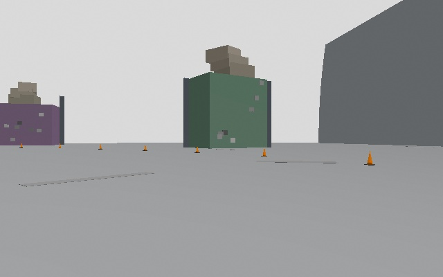
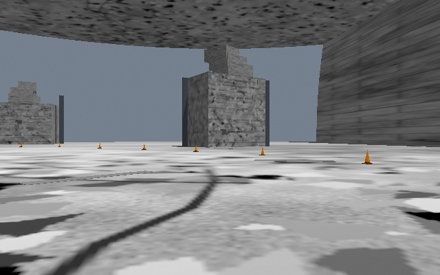

# Feature warehouse RGB-D validation — 2026-11-13

## Scope and changes

Branch: `codex/feature-warehouse-slam`. Procedural grayscale concrete aggregate and cracks, four distinct wall textures, forty individually seeded cabinet/carton textures, reduced ambient light, sun shadows, and a textured, noncolliding ceiling. The ceiling does not cast shadows: an earlier prototype blocked sunlight and impaired cone detection. All 45 PNG assets are committed and resolved with `model://feature_warehouse_materials/...`; no downloads, fiducials, encoded patterns, or orange/yellow texture pixels.

The generator preserves the original geometry RNG. Centreline, all 198 named cone poses, spawn, sidecar, original collision geometry and obstacle positions are unchanged. Minimum cluster-centre distance remains 2.6475687 m. The ceiling adds no collision. No vehicle, sensor, follower, EKF, or RTAB-Map parameter changes. MinInliers remains 20 and OptimizeMaxError 3.0. Racetrack parameter regression is therefore not applicable.

Two reusable evaluation scripts were added: `feature_probe.py` measures GFTT (quality .01, distance 7, cap 2000), ORB (cap 1500), local contrast and weakest 2 s windows; `audit_cone_frames.py` screens 20 evenly spaced RGB frames against ground-truth cone projections with a 15 px association tolerance. The latter is a spot check, not exhaustive depth-based detection validation.

## Before and after, identical pose

Both are frame 000100: old `fw_mapping` t=7.26 s and new `fw_map_v5` t=6.93 s. Ground-truth translation differs by less than 3e-10 m; yaw is unchanged. GFTT: **133 → 628**; ORB: **461 → 1176**.

## Feature measurements

| Run/window | Frames | GFTT median | Minimum / 5th percentile | Worst 2 s median | ORB median |
|---|---:|---:|---:|---:|---:|
| Old warehouse, clean t=23–40 s | 254 | 106 | 33 / 65 | 84.5 | 429.5 |
| Racetrack reference | 1042 | 404.5 | 128 / 210 | 225 | 1453.5 |
| Intermediate v4 | 1087 | 188 | 64 / 134 | 137.5 | 633 |
| Final v5 | 1037 | **639** | **387 / 510** | **532** | 1286 |

Final v5 has zero 2 s windows below 150; every individual frame exceeds 150. Contrast-area median is .3717. Whole old run median was only 29 because it includes the long post-crash period; the clean interval is the meaningful baseline. Probe outputs and per-frame CSVs are under `evaluation/fw_slam_fix/`.

## Mapping and perception

Final `fw_map_v5`: **3 laps**, 17.65 / 17.61 / 17.84 s; **25 accepted closures**; 17 rejected visual candidates, zero “Not enough features” and zero “Rejecting all added loop closures” messages. Position RMS **0.091668 m**, maximum **0.205042 m**, end **0.036736 m**; heading RMS .25565 degrees. 3315 samples cover 56.12 s after movement, largest timestamp gap .03 s. Analyzer duration was raised to 80 s because its default 47 s would omit part of lap 3.

The trajectory/error plot shows no large false-loop displacement. There are small corrections: the largest adjacent residual-vector change is **0.13252 m** at t=63.2 s, and largest scalar error change .11692 m. Thus a literal requirement for no steps whatsoever is not met; bounded corrections are present and should not be represented as a perfectly continuous estimate. All 25 accepted constraints were subsequently checked against ground truth (see the constraint audit below).

Cone map: 173/198 matched true cones, **recall .874**, precision .678 (255 mapped cones), matched RMS .083 m, maximum .197 m. 679 scored camera frames and 4783 detections. Twenty sampled final onboard frames produced **88 detections, zero unmatched**; annotated frames were visually inspected. This supports zero observed off-cone detections in that sample, not a universal zero false-positive guarantee.

## Run ledger and reliability

| Attempt | Outcome |
|---|---|
| fw_map_v2 | Aborted before a lap: initial texture URI resolution failed; corrected to model URIs. |
| fw_map_v3 | Aborted before a lap: ceiling shadow darkened cones and follower lost course; corrected ceiling shadow setting. |
| fw_map_v4 | 3 laps (17.60 / 18.30 / 21.38 s), 15 closures, RMS .08673 m, max .17933 m, recall .884; failed feature median target (188). |
| fw_map_v5 | 3 laps; passes numerical mapping, feature and recall targets above. |
| fw_loc_v5 | **Failed**, 2 laps (17.58 / 19.42 s), third-lap departure, then timeout. Full-run nav RMS **6.88162 m**, max **15.44786 m**, fixed mapping alignment. |

The first localization run crossed 1.1 m from the centreline at **t=60.56 s**, world (-9.78745, 3.12062). Maximum distance 1.88331 m; final physical pose (-10.42544, 1.96279). Evidence: `evaluation/cones_gz/fw_loc_v5/follower.csv`, `driver.log`, `log.csv`, and `evaluation/fw_slam_fix/loc_v5_analysis/comparison.png`. Wheel-odometry drift after departure invalidates full-run localization accuracy. The follower was not tuned.

## Tests and reproduction

- RL and sim-eval suites: **47 passed**.
- RC Python suite: **8 passed**.
- `colcon test --packages-select saurcon_nav saurcon_rc` and `colcon test-result --verbose`: **4 tests, 0 errors/failures**.
- Commands require sourcing `/opt/ros/jazzy/setup.bash` and `install/setup.bash` in `/home/wilson/Code/saurcon_ws`.
- Regenerate: `python3 src/middle_earth/scripts/build_feature_warehouse.py`.
- Probe: `python3 scripts/sim_eval/feature_probe.py evaluation/cones_gz/fw_map_v5 --output evaluation/fw_slam_fix/v5_probe.json`.
- Mapping analysis: `python3 scripts/sim_eval/analyze.py evaluation/cones_gz/fw_map_v5 --kind map --align --duration 80 --output evaluation/fw_slam_fix/v5_analysis`.
- Localization analysis must use `--kind nav --alignment-from evaluation/cones_gz/fw_map_v5 --duration 150`.

Other-session world-aware harness edits remain unstaged and unchanged; they are required for these runs. This commit alone does not contain those evaluation-tool dependencies. The original corrupt database was quarantined under `evaluation/fw_slam_fix/before/crashed_map_do_not_use.db`; it was never used. A clean final mapping backup is `maps/feature_warehouse_v5_mapping_backup.db`. Evaluation outputs and databases are local ignored artifacts, not committed.

## Final localization result and remaining work

The repeat `fw_loc_v5_repeat` also **failed**, completing 2 laps (18.46 / 18.35 s) before timeout. First corridor departure: t=52.53 s, world (13.18256, 3.06878), maximum centreline distance 2.52286 m. Full-run fused nav RMS **4.27656 m**, maximum **11.22217 m** over 100.65 s, using the same fixed mapping alignment. Its harness reported 7.7 camera fps and 8.5% stale control steps; these are possible timing contributors, not a proven cause. See its `follower.csv` and `evaluation/fw_slam_fix/loc_v5_repeat_analysis/`.

**Reliability totals:** 4 mapping attempts, 2 completed three laps, 1 passed the numerical feature/mapping/recall targets. For final v5 alone: mapping **1/1** completed and met those targets; localization **0/2** completed three laps and **0/2** passed full-run accuracy. No additional attempts are omitted. RTAB-Map published covariance-bearing localization fixes in both attempts (186 and 190 respectively); successful visual localization did not ensure a completed race or bounded error after course departure. Three-lap localization and “follower reliability no worse” remain **unmet/unproven**. Lap speed on the completed mapping run remained near the old clean lap of 17.6 s, but this is not a reliability guarantee.

**Outstanding:** investigate follower departure in a separately authorized task, then repeat full three-lap localization and reliability testing. Do not tune SLAM guards to hide post-departure wheel-odometry error. A literal zero-step mapping requirement is not met; the independent constraint audit below supports that the observed bounded corrections are valid closures.

Final checks: byte-identical generator output hashes across regeneration (world, sidecar, plan image and 45 textures); original include/pose/collision XML values unchanged; sidecar bytes identical; zero generated texture pixels within HSV [15,150,110]–[32,255,255]. `gz sdf -k` reports **Valid**, with existing OAK `gz_frame_id` extension warnings. Other-session tracked diff remains byte-identical to the initial snapshot. Final test rerun: 47 + 8 Python tests passed, and 4 colcon tests with no failures/errors.

Video: `evaluation/fw_slam_fix/fw_map_v5.mp4` (onboard, chase and map panels). The clean mapping backup is restored to `maps/feature_warehouse.db` after localization attempts.

## Accepted-constraint ground-truth audit

All 25 `(reference, loop)` node pairs from `closures.json` were looked up in the clean SQLite mapping database. Node stamps were used to interpolate logged ground-truth x/y/unwrapped yaw. The stored 3×4 float32 relative transform in each type-1 Link was compared with the relative planar ground-truth pose (translation rotated into the reference heading). Maximum translation discrepancy: **0.027822 m**; maximum absolute yaw discrepancy: **0.292061°**; maximum ground-truth distance between matched views: **0.415508 m**. Every logged closure has a corresponding database constraint. These are base-origin comparisons, with the small axle/model-origin lever-arm difference included in the discrepancy rather than fitted away. No false place match is indicated. Per-constraint results are retained in `evaluation/fw_slam_fix/loop_constraint_audit.json`.
