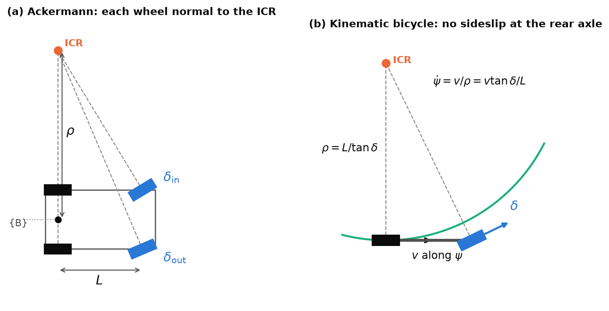
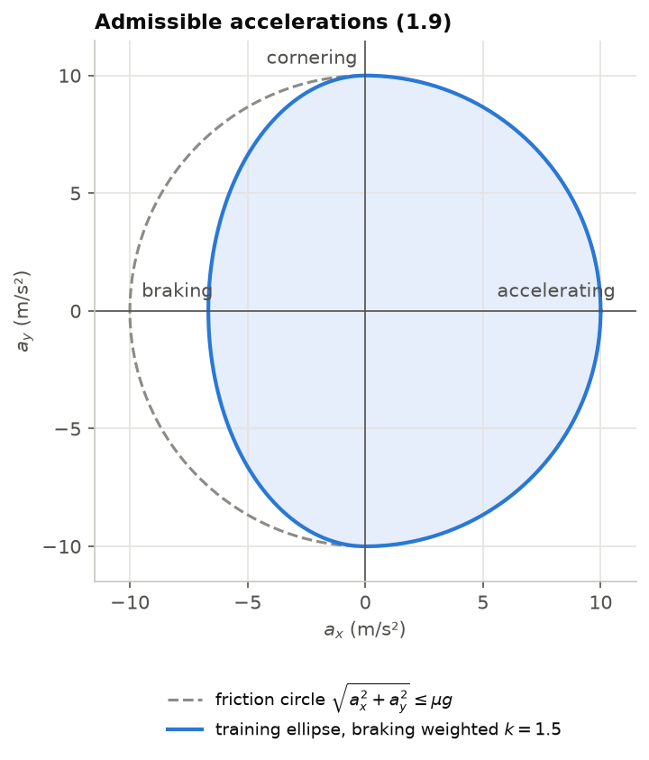
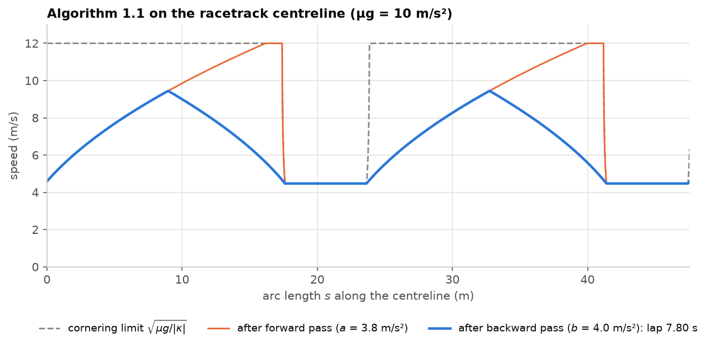

# Lecture 1 — Vehicle Modelling and System Identification

*Notebook:* [01_bicycle_model_and_sysid.ipynb](notebooks/01_bicycle_model_and_sysid.ipynb)

*Reading:* [Rajamani12] ch. 2–3; [Kong15]; [Ljung99] ch. 1 and 7.

*Further reading:* [Pacejka12] for nonlinear tyre models beyond the linear regime of §3.

## Outcomes

After this lecture you can (i) derive Ackermann geometry and the kinematic bicycle model,
and state the assumptions under which it holds; (ii) derive the linear dynamic bicycle model,
its steady-state yaw-rate gain and the understeer gradient, and compute the speed at which
the kinematic model fails; (iii) compute the minimum-time speed profile of a path under a
friction-ellipse constraint; (iv) design an identification experiment, fit parameters by
least squares, and recognise when the data reveal a defect in the plant rather than a
parameter.

## 1. Ackermann steering

When a car turns without tyre slip, every wheel's velocity is perpendicular to the line from
the wheel to a common **instantaneous centre of rotation** (ICR). The rear wheels do not steer,
so the ICR lies on the extension of the rear axle. Let $\rho$ be the distance from the ICR to
the rear-axle centre. The inner and outer front wheels, a half-track $T_w/2$ either side,
need

$$
\tan\delta_\text{in} = \frac{L}{\rho - T_w/2}, \qquad \tan\delta_\text{out} = \frac{L}{\rho + T_w/2}. \tag{1.1}
$$

A linkage that realises (1.1) for every $\rho$ is an **Ackermann linkage**; real linkages
approximate it. Gazebo's `AckermannSteering` plugin computes both angles from a commanded
yaw rate and drives the steering joints with a proportional controller. The single angle
$\delta$ used below is that of a virtual wheel on the centreline, $\tan\delta = L/\rho$.

## 2. The kinematic bicycle model

Collapse each axle to one wheel on the centreline. Take the reference point at the rear-axle
centre, with heading $\psi$, speed $v$ and front steering angle $\delta$. The no-slip
constraint at the rear wheel forces the reference point's velocity to lie along the heading,
and the ICR is at distance $\rho = L/\tan\delta$ on the rear-axle line. Hence

$$
\dot x = v\cos\psi,\qquad \dot y = v\sin\psi,\qquad \dot\psi = \frac{v}{\rho} = \frac{v}{L}\tan\delta. \tag{1.2}
$$

Choosing the rear axle removes the sideslip angle from the model; at the centre of mass, a
distance $l_r$ ahead of the rear axle, the velocity makes an angle
$\beta = \arctan\!\big(\tfrac{l_r}{L}\tan\delta\big)$ with the heading [Kong15]. The lateral
(centripetal) acceleration is

$$
a_y = v\,\dot\psi = \frac{v^2}{L}\tan\delta = v^2\kappa. \tag{1.3}
$$

**Assumptions.** Planar motion; no tyre slip; steering and speed respond instantly. The
second fails first: real tyres generate lateral force only by slipping, so (1.2) is a limit
for small $a_y$. §3 quantifies "small".

*Figure 1.1.* (a) Ackermann geometry (1.1): every wheel rolls about the instantaneous centre of rotation on the rear-axle line, so the inner front wheel steers more than the outer. (b) The kinematic bicycle (1.2): with the reference point at the rear axle, the velocity lies along the heading and the yaw rate is $v/\rho$.

**Actuators.** In SAURCON the drive is rate-limited (the speed controller ramps at fixed
acceleration $a$ and deceleration $b$) and the steering servo lags. The fast training model
uses

$$
\dot v = \operatorname{clip}\!\Big(\frac{v_\text{cmd}-v}{\Delta t},\,-b,\,a\Big), \qquad
\dot\delta = \frac{\delta_\text{cmd}-\delta}{\tau_\delta},\qquad |\dot\delta|\le\dot\delta_{\max}, \tag{1.4}
$$

with the slew limit $\dot\delta_{\max} = 8$ rad/s of the MG90S servo.

## 3. The dynamic bicycle model and the limits of kinematics

Let the forward speed $v_x$ be constant and the states be lateral velocity $v_y$ and yaw rate
$\dot\psi$, both at the centre of mass (mass $m$, yaw inertia $I_z$, axle distances $l_f$,
$l_r$, $L = l_f + l_r$). With linear tyres, the lateral force of each axle is proportional to
its **slip angle**, the angle between the wheel's heading and its velocity:

$$
\alpha_f = \delta - \frac{v_y + l_f\dot\psi}{v_x},\qquad
\alpha_r = -\frac{v_y - l_r\dot\psi}{v_x},\qquad
F_{yf} = C_f\alpha_f,\quad F_{yr} = C_r\alpha_r, \tag{1.5}
$$

where $C_f, C_r$ are the axle cornering stiffnesses. Newton–Euler in the body frame gives

$$
m(\dot v_y + v_x\dot\psi) = F_{yf} + F_{yr},\qquad I_z\ddot\psi = l_f F_{yf} - l_r F_{yr}. \tag{1.6}
$$

**Steady state.** Setting $\dot v_y = \ddot\psi = 0$ and eliminating $v_y$ yields the classic
steady-state steering relation [Rajamani12, §3.3]

$$
\delta = \frac{L}{\rho} + K_{us}\,a_y,\qquad
K_{us} = \frac{m}{L}\Big(\frac{l_r}{C_f} - \frac{l_f}{C_r}\Big), \tag{1.7}
$$

with **understeer gradient** $K_{us}$ in rad per m/s². Using $a_y = v_x\dot\psi$ and
$\rho = v_x/\dot\psi$, the yaw-rate gain is

$$
\frac{\dot\psi}{\delta} = \frac{v_x}{L + K_{us}v_x^2}. \tag{1.8}
$$

The kinematic gain is $v_x/L$; the two differ by the factor $L/(L+K_{us}v_x^2)$. An
understeering car ($K_{us}>0$) has a *characteristic speed* $v_\text{ch}=\sqrt{L/K_{us}}$ at
which its yaw gain peaks; an oversteering car ($K_{us}<0$) becomes unstable above the
*critical speed* $\sqrt{-L/K_{us}}$. Problem 1.3 asks for the speed at which the kinematic
model is 10% wrong.

**The friction limit.** Tyres can supply at most about $\mu N$ of horizontal force, so
$\sqrt{a_x^2 + a_y^2}\le\mu g$ (the *friction circle*). SAURCON brakes with the rear wheels
only; braking unloads them as load transfers forward, so braking consumes grip faster than
cornering. The training model uses a **friction ellipse** with braking weighted by $k$:

$$
\sqrt{(k\,a_x)^2 + a_y^2}\le\mu g,\qquad k = \begin{cases}1.5 & a_x<0\\ 1 & a_x\ge 0.\end{cases} \tag{1.9}
$$

Beyond (1.9) the car does not follow (1.2) at all: in the identification data the Gazebo car
spun with slip angles of 35–100°.

*Figure 1.2.* Accelerations the training model admits (1.9). Rear-only braking makes the braking side of the friction circle smaller by the factor $k = 1.5$; combined braking and cornering is where the Gazebo car spun (L6 §6).

## 4. Minimum-time speed profiles

Given a path with curvature $\kappa(s)$ along arc length $s$, what is the fastest feasible
speed profile $v(s)$? Under the quasi-steady-state assumption (the car follows the path, and
(1.9) bounds the acceleration at every point), three constraints apply:

$$
v(s) \le \sqrt{\mu g/|\kappa(s)|},\qquad
\frac{d(v^2)}{ds} \le 2a,\qquad
-\frac{d(v^2)}{ds} \le 2b. \tag{1.10}
$$

The first is the cornering limit; the second and third follow from $a_x = v\,dv/ds =
\tfrac12\,d(v^2)/ds$. Working in $v^2$ makes the acceleration constraints linear, and the
optimum is found by two sweeps:

> **Algorithm 1.1 (forward–backward speed profile).**
> 1. Set $\bar v_i^2 = \mu g/|\kappa_i|$ at samples $s_i$ (capped by $v_{\max}^2$).
> 2. Forward pass: $v_{i+1}^2 \leftarrow \min(\bar v_{i+1}^2,\ v_i^2 + 2a\,\Delta s)$.
> 3. Backward pass: $v_i^2 \leftarrow \min(v_i^2,\ v_{i+1}^2 + 2b\,\Delta s)$.
> 4. Lap time $T = \sum_i \Delta s / \tfrac12(v_i + v_{i+1})$.

The result is the pointwise-largest profile satisfying (1.10), hence minimum-time for the
given path. (Using the full ellipse (1.9) rather than separate bounds couples the passes
through $a_y = v^2\kappa$; the two-pass structure survives.) For the racetrack's 2 m bends
and $\mu g = 10$ m/s², the cornering limit is $\sqrt{20} = 4.47$ m/s. Notebook 05 applies
Algorithm 1.1 to the racetrack centreline and obtains a lower bound of 7.80 s for a car
that keeps to the centreline; a car that uses the track width can beat it (L6 §5). The
classical follower of L9 runs a local, receding-horizon version of the same idea on the path
it can see.

*Figure 1.3.* Algorithm 1.1 on the racetrack centreline with $a = 3.8$ and $b = 4.0$ m/s². The forward pass (orange) limits acceleration out of each bend; the backward pass (blue) limits braking into the next. The resulting bound, 7.80 s, is the number notebook 05 computes.

## 5. System identification

A model is useful only if its parameters match the plant. Identification is an experiment,
and it is designed like one [Ljung99].

**Inputs must excite what you want to learn.** SAURCON's identification drive
(`sysid.py`, on an empty floor so nothing interferes) uses: a full-throttle run and a braking
stop (acceleration and deceleration limits); a steering step at constant speed (time constant
$\tau_\delta$); and a grid of constant speed × steering holds (steady-state yaw gain and the
grip plateau). An input that never saturates the grip cannot identify $\mu$.

**Least squares.** Most parameters enter linearly once the model is discretised. For the
steering lag, $\delta_{k+1} = \phi\,\delta_k + (1-\phi)\,\delta_{\text{cmd},k}$ with
$\phi = e^{-\Delta t/\tau_\delta}$; stacking $N$ samples gives
$\mathbf y = \Phi\,\theta$ with $\theta = \phi$, solved by
$\hat\theta = (\Phi^\top\Phi)^{-1}\Phi^\top\mathbf y$ and $\hat\tau_\delta =
-\Delta t/\ln\hat\phi$. The estimate's covariance is $\hat\sigma^2(\Phi^\top\Phi)^{-1}$:
poorly excited parameters announce themselves through large variance.

**Differentiation amplifies noise.** Speed and yaw rate are obtained by differencing logged
poses. With position noise $\sigma_p$, a finite difference over $\Delta t$ has noise
$\sqrt2\,\sigma_p/\Delta t$, and acceleration (a second difference) is worse again. Smooth
first (a Savitzky–Golay filter is the standard choice), or fit in the integrated domain.
Noisy regressors also bias least squares toward zero (the *errors-in-variables* problem), so
estimates of gains from noisy derivatives are systematically small.

**Validate on data the fit did not see**, and look at residuals against each input. A
residual pattern is information about the model, not noise.

**Results for the Gazebo car.** Traction-limited acceleration 4.1 m/s² and braking 4.5 m/s²;
steady yaw rate within 2% of (1.2) at 3 m/s; steering time constant ≈ 0.2 s; lateral grip
plateau median 9.8 m/s² (quartiles 7.5–11.4). Notebook 01 reproduces these from
`docs/course/data/sysid.csv`. The drive's ramps were then set just under the traction limit
(3.8 and 4.0 m/s²); L6 §6 shows what happened before they were.

## 6. From the lab: identification finds a defect in the plant

The first identification run gave a top speed of **1.7 m/s regardless of the command**, and
almost no turning above 3 m/s. No parameter of (1.2)–(1.4) can produce a speed that ignores
the command, so the data said the *plant* was wrong, not the parameters. A focused test
printed wheel speeds: the driven rear wheels spun at the commanded rate (152 rad/s for 5 m/s)
while the free front wheels turned at 50 rad/s. The rear tyres were slipping.

The cause was a viscous damping of $c = 0.01$ N·m·s/rad on every wheel joint of the Gazebo
model. The damping torque $c\omega$ at 50 rad/s is 0.5 N·m; on a 33 mm wheel that is a
**15 N** drag force per front wheel, as much as the rear tyres' entire grip. The car
accelerated until drag equalled traction and stayed there. With the damping reduced
a hundredfold, drag at 10 m/s is about 1 N per wheel and the car follows any command.

**Lessons.** Units hide scale: a "small" coefficient is not small on a small wheel, so check
every parameter at operating conditions. And identification is also verification: if the
data are physically implausible, inspect the plant before fitting it.

## In SAURCON

| Concept | Where |
|---|---|
| Car geometry, joints, steering plugin | `src/middle_earth/models/rc_ackermann_vehicle/model.sdf` |
| Identification drive (Gazebo and MuJoCo) | `src/saurcon_rl/saurcon_rl/sysid.py` |
| Car parameters shared by planner and simulators | `src/saurcon_plan/saurcon_plan/vehicle.py` |
| Kinematic model with (1.4) and (1.9), used for RL | `src/saurcon_rl/saurcon_rl/env.py` (`RaceEnv.step`) |
| Wheel-speed odometry in simulation | `src/saurcon_rc/src/sim_saurcon_rc.cpp` |

## Summary

- The rear-axle reference point makes the kinematic bicycle model sideslip-free; it holds
  while $a_y$ is small compared with the grip.
- The dynamic model's yaw gain $v/(L+K_{us}v^2)$ quantifies when kinematics fails; the
  understeer gradient decides stability.
- Minimum-time speed planning under acceleration bounds reduces to two linear sweeps in
  $v^2$.
- Identification needs designed excitation, careful differentiation, validation on held-out
  data, and the humility to suspect the plant.

## Problems

**1.1** [T] ★ Compute $\delta_\text{in}$ and $\delta_\text{out}$ for SAURCON at $\rho = 2$ m.

**1.2** [T] ★ Derive (1.7) from (1.5)–(1.6). State which sign of $K_{us}$ a car with rear-only
braking tends toward under hard braking, and why.

**1.3** [T] ★★ Using (1.8), find the speed at which the kinematic yaw gain is 10% too high.
Express it in terms of $v_\text{ch}$.

**1.4** [C] ★★ Implement Algorithm 1.1 for the racetrack centreline (notebook 05 provides
it) with the ellipse (1.9) in place of separate bounds. How much does the braking weight
$k = 1.5$ change the lap time? Where on the lap?

**1.5** [C] ★★ In notebook 01, fit $\tau_\delta$ by least squares on the steering-step data.
Report the estimate with a standard error, and compare a fit on raw finite differences with a
fit on Savitzky–Golay-smoothed data.

**1.6** [T] ★★ Show that for a regressor observed with additive noise of variance
$\sigma_u^2$, the least-squares slope converges to $\theta\,\sigma_x^2/(\sigma_x^2+\sigma_u^2)$.

**1.7** [S] ★★★ Design an identification experiment for the physical car that needs no motion
capture. Which signals serve as ground truth for speed, yaw rate and lateral acceleration,
what are their error models, and how many repetitions does each parameter need for a 5%
standard error?

### Answers to selected problems

**1.1** $\tan\delta_\text{in} = 0.254/1.9175$, so $\delta_\text{in} = 0.1317$ rad (7.55°);
$\tan\delta_\text{out} = 0.254/2.0825$, so $\delta_\text{out} = 0.1214$ rad (6.95°).

**1.3** $L/(L+K_{us}v^2) = 1/1.1$ gives $K_{us}v^2 = L/10$, i.e. $v = v_\text{ch}/\sqrt{10}
\approx 0.32\,v_\text{ch}$. (If "10% wrong" is read as the kinematic gain being 10% *above*
the true gain, the answer is the same to first order.)

**1.6** $\hat\theta = \operatorname{cov}(x+u, y)/\operatorname{var}(x+u) \to
\theta\sigma_x^2/(\sigma_x^2+\sigma_u^2)$, since $u$ is uncorrelated with $x$ and with the
output noise: attenuation bias.
