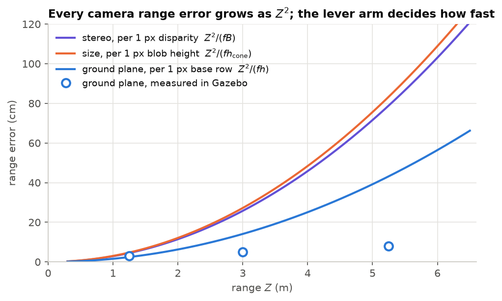

# Lecture 2 — Sensors and Measurement Models

*Notebook:* [02_camera_geometry_and_pnp.ipynb](notebooks/02_camera_geometry_and_pnp.ipynb)

*Reading:* [Hartley04] ch. 6; [Szeliski22] §2.1 and §12.1; [Collins14]; [Thrun05] ch. 5–6.

*Further reading:* [Lepetit09] for the general (non-planar) PnP problem.

## Outcomes

After this lecture you can (i) write error models for wheel odometry and a MEMS gyroscope and
predict how their errors grow with time; (ii) project points with the pinhole model and relate
focal length to field of view; (iii) derive stereo depth and its range-dependent error, and
propagate pixel errors to metric errors in general; (iv) recover a planar marker's pose by PnP,
explain the two-fold ambiguity, and compose the result into a vehicle pose.

## 1. Proprioceptive sensors

**Wheel odometry.** Speed is $v = r_w\,\omega_w$ averaged over the driven wheels. Its errors
have three sources with different statistics: a *scale* error from the wheel radius $r_w$ (a 1%
radius error is a 1% distance error, systematic and unbounded in distance), *slip* under
acceleration and cornering (state-dependent, biased toward over-reading when driven wheels
spin), and *quantisation* of the encoder (white, small). In SAURCON the ESP32 publishes speed
and steering angle on `/saurcon/odom`; in simulation `sim_saurcon_rc` computes them from
Gazebo joint states.

**Gyroscope.** A MEMS gyro measures

$$
\omega_\text{meas} = \omega + b + n,\qquad n\sim\mathcal N(0,\sigma_n^2)\ \text{per sample}, \tag{2.1}
$$

with a slowly varying bias $b$. Integrating at period $\Delta t$ for time $t$ gives a heading
error

$$
\delta\psi(t) = b\,t + \sum_{k=1}^{t/\Delta t} n_k\Delta t,\qquad
\operatorname{std}\Big(\sum n_k\Delta t\Big) = \sigma_n\sqrt{\Delta t\,t}. \tag{2.2}
$$

The first term grows linearly, the second as $\sqrt t$ (*angle random walk*); the bias term
dominates beyond a few seconds. A bias of only 0.001 rad/s is 11.5° after 200 s. Averaging $N$
stationary samples estimates $b$ with error $\sigma_n/\sqrt N$, a fact that becomes a case
study in L3 §7.

## 2. The pinhole camera

A point $\mathbf p = (X, Y, Z)$ in the **optical frame** $\{C\}$ ($x$ right, $y$ down, $z$
forward) projects to pixel $(u, v)$:

$$
\lambda\begin{bmatrix}u\\v\\1\end{bmatrix} = K\begin{bmatrix}X\\Y\\Z\end{bmatrix},\qquad
K = \begin{bmatrix}f_x & 0 & c_x\\ 0 & f_y & c_y\\ 0&0&1\end{bmatrix},\qquad \lambda = Z. \tag{2.3}
$$

For an image $W$ pixels wide with horizontal field of view $\theta$,
$f_x = \dfrac{W/2}{\tan(\theta/2)}$. SAURCON's camera is 640 px wide with $\theta = 1.204$ rad,
so $f_x = 465.7$ px. A configuration file once said 929.4 px, consistent with a 1280-px stream
of the same lens, not this one: **derive intrinsics from the stream you actually receive.**

**Body vs. optical frames.** ROS body frames are $x$ forward, $y$ left, $z$ up; optical frames
are $x$ right, $y$ down, $z$ forward. The fixed rotation between them (L0, problem 0.4) is the
most common source of perception bugs, and its symptom is distinctive: poses that are almost
right but rotated by 90°.

**Error propagation.** For any measurement $\mathbf y = g(\mathbf x)$ with $\mathbf x$ noisy,
the first-order covariance is $\Sigma_y = J\,\Sigma_x J^\top$ with $J = \partial g/\partial
\mathbf x$. We use this repeatedly: for stereo below, for ground-plane cone ranging in L9, and
for the filter of L3.

## 3. Stereo depth

Two rectified cameras a baseline $B$ apart see a point at disparity $d = u_L - u_R$. From
similar triangles,

$$
Z = \frac{fB}{d},\qquad \frac{\partial Z}{\partial d} = -\frac{fB}{d^2} = -\frac{Z^2}{fB},\qquad
\sigma_Z \approx \frac{Z^2}{fB}\,\sigma_d. \tag{2.4}
$$

Depth error grows with the **square** of range. The OAK-D Lite has $B = 75$ mm; with
$f\approx 450$ px and a sub-pixel matching error $\sigma_d = 0.1$ px, $\sigma_Z$ is 0.7 mm at
0.5 m but 7 cm at 5 m. Passive stereo also fails where there is no texture to match, returning
invalid (zero) depth; small, plain objects such as traffic cones produce holes. SAURCON's
simulated OAK-D reproduces both effects (`saurcon_nav/scripts/oak_depth.py`), and L9 shows how
much they matter for ranging cones.

*Figure 2.1.* Range error produced by a one-pixel error, for stereo (2.4), cone-size ranging and ground-plane ranging (9.1), with the OAK-D Lite's parameters. All grow as $Z^2$; ground-plane ranging has the largest lever arm (the 0.137 m camera height). Circles: ground-plane errors measured in Gazebo, smaller than one pixel's worth because the base row is located to sub-pixel consistency.

## 4. Fiducial markers and Perspective-n-Point

An ArUco marker [GarridoJurado14] is a square of known side $s$ carrying a binary code.
Detection finds its four corners $\mathbf p_i$ in the image. **Perspective-n-Point** finds the
rotation and translation of the marker in the camera frame that best reproject the known 3-D
corners $\mathbf P_i$:

$$
\min_{\mathbf C,\mathbf t}\ \sum_{i=1}^{4}\big\|\pi\big(K(\mathbf C\mathbf P_i + \mathbf t)\big) - \mathbf p_i\big\|^2, \tag{2.5}
$$

where $\pi$ divides by the third coordinate. For a planar target the problem is a homography,
and the IPPE solver [Collins14] returns its two local minima in closed form. **The planar
ambiguity:** when the marker is small in the image or viewed nearly head-on, the two solutions
have nearly equal reprojection error but orientations mirrored about the line of sight. No
amount of optimisation distinguishes them; only more information (a second marker, motion, a
prior) can.

**Composing a vehicle pose.** With the marker's surveyed pose ${}^{W}T_{M}$, the camera mounting
${}^{B}T_{C}$ and the PnP result ${}^{C}T_{M}$,

$$
{}^{W}T_{B} = {}^{W}T_{M}\,\big({}^{B}T_{C}\,{}^{C}T_{M}\big)^{-1}. \tag{2.6}
$$

An orientation error $\epsilon$ in ${}^{C}T_{M}$ rotates the inverse about the marker, moving
the vehicle laterally by approximately $\epsilon\times$range (problem 2.3). Marker
localization is therefore precise near markers and fragile far from them.

## 5. From the lab

**Two errors cancelling in one regime.** The marker texture has a 10% white margin, so the black
square is 0.122 m, not the 0.1524 m plate. At close range the detector locked onto the plate
edge, which *did* measure 0.1524 m, so range was right; farther away it locked onto the real
black square and range came out 12–21% long. A test at one distance would have passed.
**Lesson:** validate across the operating range, not at a convenient point.

**The marker map that was 180° off.** Two markers across the track ends had their facing
direction recorded with the wrong sign. Seen from the correct side, the localizer placed the car
mirrored through the marker, 3.6 m away and facing backwards. It was found by teleporting the
car in front of each marker and comparing (2.6) with ground truth, a check worth automating for
any map.

**Ambiguity under trust.** Once the filter actually trusted marker fixes, ambiguous PnP
solutions made the estimate jump by up to 1.6 m. The fix rejects detections whose two IPPE
solutions disagree by more than 15° while having nearly equal error, and inflates the
measurement noise by $1 + (\text{range}/1.5\,\text{m})^2$, the same square law as (2.4).
**Lesson:** a measurement model must include its failure modes, not only its noise.

## In SAURCON

| Concept | Where |
|---|---|
| Simulated OAK-D Lite (RGB, stereo, IMU) | `src/middle_earth/models/oak_d_lite/` |
| Depth degradation model | `src/saurcon_nav/scripts/oak_depth.py` |
| ArUco detection and IPPE | `src/saurcon_perception/src/aruco_detector.cpp` |
| Marker → vehicle pose (2.6) | `src/saurcon_perception/src/aruco_localizer_node.cpp` |

## Summary

- Odometry error is mostly systematic (scale, slip); gyro heading error is dominated by bias.
- Stereo depth error grows as $Z^2$; pixel errors always propagate through a Jacobian.
- Planar PnP has two near-equal solutions; treat the ambiguity as part of the measurement model.

## Problems

**2.1** [T] ★ Compute $f_x$ for a 1280-px stream with the same field of view. How does the
stereo depth error at 5 m change, all else equal?

**2.2** [C] ★ In notebook 02, project a 0.122 m marker at 1, 3 and 5 m. How many pixels wide is
it, and what does that imply for corner noise in metres?

**2.3** [T] ★★ Show that for (2.6), a yaw error $\epsilon$ in ${}^{C}T_{M}$ moves the vehicle
laterally by $\approx \epsilon\,\|{}^{C}\mathbf t_{M}\|$ to first order.

**2.4** [C] ★★ Reproduce the IPPE ambiguity in the notebook: with 0.3 px corner noise, at what
range do the two solutions' reprojection errors become statistically indistinguishable?

**2.5** [T] ★★ A gyro has $\sigma_n = 0.009$ rad/s at 100 Hz and an unknown constant bias. How
long must the car stand still for the bias estimate to contribute less than 1° of heading error
over a 3-minute run?

**2.6** [T] ★★★ The OAK-D Lite computes depth in its left mono camera and aligns it to the
colour camera. Write the transform chain and the per-pixel operations needed, and identify which
step creates the depth holes at object boundaries.

### Answers to selected problems

**2.1** $f_x = 931.4$ px. With $f$ doubled, (2.4) halves $\sigma_Z$ for the same $\sigma_d$ in
pixels: about 3.5 cm at 5 m (in practice $\sigma_d$ in pixels also changes with resolution).

**2.5** The bias error is $\sigma_n/\sqrt N$; over $t = 180$ s it contributes
$t\,\sigma_n/\sqrt N \le 0.01745$ rad, so $N \ge (180\cdot 0.009/0.01745)^2 \approx 8{,}600$
samples, i.e. about 86 s at 100 Hz. Standing still that long is impractical, which is why L3
accumulates bias samples whenever the car is stationary rather than only at start-up.
