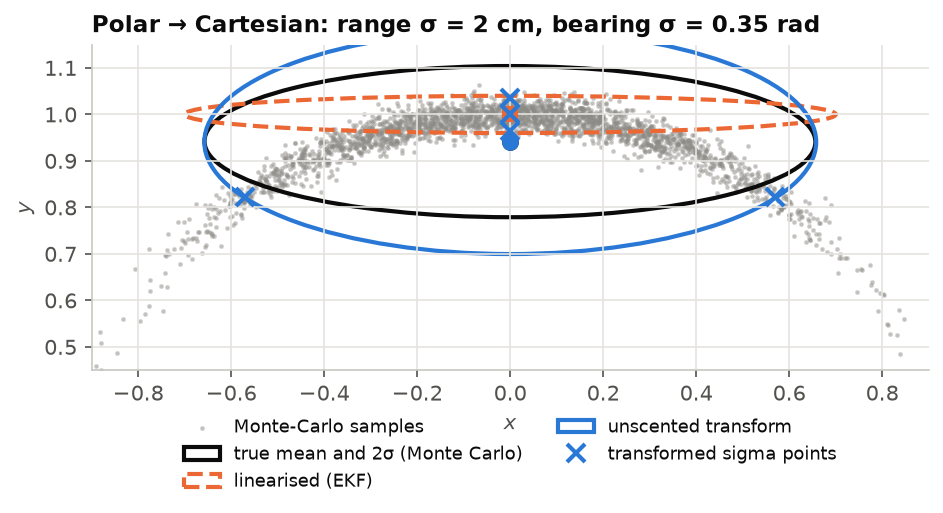

# Lecture 3 — Nonlinear State Estimation

*Notebook:* [03_unscented_kalman_filter.ipynb](notebooks/03_unscented_kalman_filter.ipynb)

*Reading:* [Thrun05] ch. 2–3; [Julier04]; [BarShalom01] §5.4 (consistency); [Barfoot24] ch. 4.

*Further reading:* [Kalman60], the original paper; [Wan00] for the UKF in parameter estimation.

## Outcomes

After this lecture you can (i) derive the Kalman filter from the Bayes filter and Gaussian
conditioning; (ii) implement the unscented transform and explain its accuracy and its numerical
hazards; (iii) design process and measurement noise, gate outliers with the Mahalanobis distance,
and test consistency with NEES and NIS; (iv) handle sensor bias, measurement latency and
numerical failure in a deployed filter.

## 1. The estimation problem

SAURCON's filter estimates $\mathbf x = [x,\ y,\ \psi,\ v]^\top$. Wheel speed and the gyro's
yaw rate drive a **prediction**; pose fixes (ArUco markers or RTAB-Map) arrive occasionally as
**measurements** $\mathbf z = [x,\ y,\ \psi]^\top$. The **Bayes filter** maintains the posterior
$p(\mathbf x_k\mid\mathbf z_{1:k},\mathbf u_{1:k})$ by alternating

$$
\underbrace{p(\mathbf x_k\mid\mathbf z_{1:k-1}) = \int p(\mathbf x_k\mid\mathbf x_{k-1},\mathbf u_k)\,p(\mathbf x_{k-1}\mid\mathbf z_{1:k-1})\,d\mathbf x_{k-1}}_{\text{prediction}},\qquad
\underbrace{p(\mathbf x_k\mid\mathbf z_{1:k}) \propto p(\mathbf z_k\mid\mathbf x_k)\,p(\mathbf x_k\mid\mathbf z_{1:k-1})}_{\text{update}}. \tag{3.1}
$$

Every filter in this course is an approximation of (3.1). The Kalman filter is exact when the
models are linear and the noise Gaussian.

## 2. The Kalman filter

Let $\mathbf x_k = F\mathbf x_{k-1} + G\mathbf u_k + \mathbf w_k$ and $\mathbf z_k = H\mathbf x_k
+ \mathbf n_k$ with $\mathbf w\sim\mathcal N(\mathbf 0,Q)$, $\mathbf n\sim\mathcal N(\mathbf 0,R)$.
A Gaussian pushed through a linear map stays Gaussian, so the prediction is

$$
\hat{\mathbf x}^- = F\hat{\mathbf x} + G\mathbf u,\qquad P^- = FPF^\top + Q. \tag{3.2}
$$

For the update, write the joint distribution of state and measurement under the prediction:

$$
\begin{bmatrix}\mathbf x\\ \mathbf z\end{bmatrix}\sim\mathcal N\!\left(
\begin{bmatrix}\hat{\mathbf x}^-\\ H\hat{\mathbf x}^-\end{bmatrix},
\begin{bmatrix}P^- & P^-H^\top\\ HP^- & S\end{bmatrix}\right),\qquad S = HP^-H^\top + R.
$$

Conditioning a joint Gaussian on its second block gives mean
$\hat{\mathbf x}^- + P^-H^\top S^{-1}(\mathbf z - H\hat{\mathbf x}^-)$ and covariance
$P^- - P^-H^\top S^{-1}HP^-$. Naming the **innovation** $\boldsymbol\nu = \mathbf z -
H\hat{\mathbf x}^-$ and the **gain** $K = P^-H^\top S^{-1}$,

$$
\hat{\mathbf x} = \hat{\mathbf x}^- + K\boldsymbol\nu,\qquad
P = (I-KH)P^-(I-KH)^\top + KRK^\top. \tag{3.3}
$$

The covariance is written in **Joseph form**: algebraically equal to $(I-KH)P^-$ for the optimal
$K$ (problem 3.1), but a sum of positive semi-definite terms, so it stays symmetric and positive
definite under rounding and for any $K$.

**Nonlinear models.** SAURCON's models are $\mathbf x_k = f(\mathbf x_{k-1},\mathbf u_k) +
\mathbf w_k$ and $\mathbf z_k = h(\mathbf x_k) + \mathbf n_k$, with headings inside sines and
cosines. The **EKF** linearises $f$ and $h$ at the estimate and applies (3.2)–(3.3) with
Jacobians. The **UKF** instead propagates a set of deterministically chosen samples through the
true nonlinearity.

## 3. The unscented transform

For $\mathbf x\sim\mathcal N(\hat{\mathbf x},P)$ of dimension $n$, choose $2n+1$ **sigma points**

$$
\mathcal X_0 = \hat{\mathbf x},\qquad \mathcal X_{\pm i} = \hat{\mathbf x}\pm\Big(\sqrt{(n+\lambda)P}\Big)_i,\qquad
\lambda = \alpha^2(n+\kappa) - n, \tag{3.4}
$$

where $(\sqrt{A})_i$ is the $i$-th column of a matrix square root (a Cholesky factor). With
weights

$$
W^m_0 = \frac{\lambda}{n+\lambda},\qquad W^c_0 = W^m_0 + (1-\alpha^2+\beta),\qquad
W^m_i = W^c_i = \frac{1}{2(n+\lambda)}, \tag{3.5}
$$

the transformed mean and covariance of $\mathbf y = g(\mathbf x)$ are
$\hat{\mathbf y} = \sum_i W^m_i g(\mathcal X_i)$ and
$P_y = \sum_i W^c_i (g(\mathcal X_i)-\hat{\mathbf y})(\cdot)^\top$. The sigma points match the
mean and covariance of $\mathbf x$ exactly, so the transformed mean is correct to second order in
the Taylor expansion of $g$ (third order for Gaussians), versus first order for the EKF, and no
Jacobian is needed [Julier04]. The update uses the cross-covariance
$P_{xz} = \sum_i W^c_i(\mathcal X_i-\hat{\mathbf x}^-)(\mathcal Z_i-\hat{\mathbf z})^\top$ in
place of $P^-H^\top$, so $K = P_{xz}S^{-1}$.

*Figure 3.1.* A Gaussian in range and bearing pushed through the polar-to-Cartesian map. Linearisation (orange) places the mean at the nominal point $y = 1$ and its ellipse is too thin; five sigma points (blue crosses) recover the Monte-Carlo mean ($y = 0.941$) and spread. The curved shape is what a single Gaussian cannot represent at all.

**Angles.** Means and differences of headings must be computed on the circle: average as
$\operatorname{atan2}(\sum W_i\sin\psi_i, \sum W_i\cos\psi_i)$, difference with
$\operatorname{wrap}$.

**Parameters and their hazard.** SAURCON uses $n=4$, $\alpha = 0.1$, $\beta = 2$, $\kappa = 0$.
Then $\lambda = -3.96$, $n+\lambda = 0.04$, $W^m_0 = -99$, $W^c_0 \approx -96$ and
$W_i = 12.5$. Small $\alpha$ keeps sigma points close to the mean (good for strong
nonlinearity), but the large negative central weight means the computed covariance is a
difference of large numbers and can become indefinite. The implementation therefore symmetrises
$P$, floors its diagonal, and adds jitter when the Cholesky factorisation fails
(`sigmaRoot`, `conditionCovariance` in `state_estimator.cpp`). Problem 3.2 explores the
boundary.

## 4. The motion model

With bias-corrected gyro rate $\omega$ and wheel speed $v$ as inputs over $\Delta t$, the
constant turn-rate and velocity (CTRV) model integrates (1.2) exactly:

$$
\begin{aligned}
x' &= x + \tfrac{v}{\omega}\big(\sin(\psi+\omega\Delta t)-\sin\psi\big),\\
y' &= y + \tfrac{v}{\omega}\big(\cos\psi-\cos(\psi+\omega\Delta t)\big),\qquad \psi' = \psi + \omega\Delta t,
\end{aligned} \tag{3.6}
$$

with the straight-line limit when $|\omega|\Delta t\to 0$ (switch to it below a threshold,
not at exactly zero, to avoid catastrophic cancellation). Process noise represents gyro noise
(in $\psi$), speed noise (in $v$) and slip, modelled as position noise growing with speed.

## 5. Designing for contact with reality

**Gating.** For a correct model, the normalised innovation squared
$d^2 = \boldsymbol\nu^\top S^{-1}\boldsymbol\nu$ is $\chi^2_m$-distributed with $m = \dim\mathbf
z$. Rejecting $d^2 > \chi^2_{m,1-p}$ discards a fraction $p$ of good measurements and most gross
outliers. SAURCON rejects $d^2 > 25$ ($p\approx 10^{-5}$ for $m = 3$).

**The gating trap.** Gating is only as good as $S$. If $P$ collapses (too little process noise),
$S$ shrinks, true measurements fail the gate, and with no updates $P$ never recovers. The first
SAURCON filter gave position *no* process noise and, after a few seconds, ignored every fix
forever. The remedy has two parts: process noise that reflects real model error, and a recovery
rule (re-initialise after 15 consecutive rejections) so that a single bad state cannot become
permanent.

**Consistency.** A filter is consistent if its errors are distributed as its covariance claims.
With ground truth, the **NEES** $\epsilon_k = \tilde{\mathbf x}_k^\top P_k^{-1}\tilde{\mathbf
x}_k$ should average $n$; without it, the **NIS** $d_k^2$ should average $m$, and its time-average
over $N$ steps lies in a $\chi^2_{Nm}/N$ interval [BarShalom01]. Over-confident filters gate out
good data; under-confident ones are sluggish. L4 §5 deliberately runs the odometry filter
under-confident in position, because RTAB-Map reads its uncertainty and a tight variance there
has a different job.

**Bias as a state, or bias by physics.** Gyro bias can be added to the state and estimated from
pose fixes (problem 3.3). SAURCON uses a cheaper observation: an Ackermann car **cannot yaw while
its wheels are stopped**, so every gyro sample taken while stationary is a measurement of $b$
(a zero-velocity update). §7 shows why this matters.

**Latency.** A pose fix describes the instant its image was taken, often 100–500 ms earlier; at
8 m/s that is up to 4 m. Fusing it as if current is a large, systematic error. With odometry
poses $\mathbf o_t$ and $\mathbf o_\text{now}$, SAURCON's global filter moves the fix to the
present before fusing:

$$
\mathbf z_\text{now} = \mathbf z_t \oplus \big(\ominus\mathbf o_t\oplus\mathbf o_\text{now}\big). \tag{3.7}
$$

This is exact if odometry is exact over the interval, and its error is the odometry drift over
the latency, millimetres instead of metres. The general lesson, that every composition needs all
of its terms at one instant, returns in L4 §5.

## 6. Algorithm

> **Algorithm 3.1 (SAURCON UKF, one cycle at 50 Hz).**
> 1. Predict: sigma points (3.4) from $(\hat{\mathbf x},P)$; propagate through (3.6) with the
>    latest $v$ and bias-corrected $\omega$; recombine with (3.5); add $Q$; condition $P$.
> 2. If stationary (wheel speed ≈ 0 and $|\omega_\text{meas}|<0.1$ rad/s), add the gyro sample to
>    the running bias mean (capped at 6,000 samples to track slow drift).
> 3. For each new pose fix: shift it to now with (3.7); predict $\hat{\mathbf z}$ and $S$ from
>    the sigma points; gate with $d^2 \le 25$; update with $K = P_{xz}S^{-1}$ in Joseph form; on
>    15 consecutive rejections, re-initialise at the fix.
> 4. Publish $\hat{\mathbf x}$ with covariance, and the transform this instance owns.

## 7. From the lab

**The one-second bias calibration.** At start-up the filter averaged 100 stationary gyro samples
(1 s at 100 Hz) to estimate bias. The simulated gyro has *no* bias, only noise with
$\sigma_n = 0.009$ rad/s, so the "bias estimate" was pure noise with standard deviation
$0.009/\sqrt{100} = 0.0009$ rad/s, which by (2.2) is 11° over a 216 s run. Subtracting it
*injected* the error it meant to remove: 13° of heading drift and 1.7 m RMS position error.
Earlier runs had looked fine by luck of the draw. With the stationary-update rule of
Algorithm 3.1 step 2, odometry error fell from 1.73 m to 0.08–0.18 m RMS over four laps.
**Lessons:** a calibration is a measurement with its own error, and a result that depends on the
seed was never a result.

**Initialisation order in C++.** When a second filter instance was added, both behaved as the
global one. The node declared `bool fuse_{true};` *after* the filter member whose constructor
set it; C++ initialises members in declaration order, so the default initialiser ran last and
overwrote the parameter. The bug surfaced only as a TF symptom in another node ("frame odom does
not exist"). **Lesson:** never set a member from another member's initialiser unless the order is
guaranteed; and expect configuration bugs to surface far from their cause.

## In SAURCON

| Concept | Where |
|---|---|
| UKF core: sigma points, prediction, update, gating, bias | `src/saurcon_nav/src/state_estimator.cpp` |
| ROS wrapper: modes, latency compensation (3.7), TF | `src/saurcon_nav/src/state_estimator_node.cpp` |
| Unit tests: dead reckoning, bias refinement | `src/saurcon_nav/test/test_dead_reckoning.cpp` |
| Comparison with ground truth | `scripts/sim_eval/plot_ukf.py` |

## Summary

- The Kalman filter is Gaussian conditioning; the Joseph form keeps it numerically honest.
- The unscented transform buys second-order accuracy without Jacobians, at the price of
  negative weights that require covariance conditioning.
- Gating, consistency, bias and latency are where deployed filters actually fail; each has a
  principled test.

## Problems

**3.1** [T] ★ Show that the Joseph form equals $(I-KH)P^-$ when $K = P^-H^\top S^{-1}$, and that
it differs for any other $K$.

**3.2** [C] ★ In notebook 03, sweep $\alpha$ from 0.001 to 1 with $n = 4$. Plot $W^c_0$ and the
minimum eigenvalue of the predicted covariance for a sharp turn. Where does it become indefinite?

**3.3** [C] ★★ Add a gyro-bias state to the notebook filter. Show that it converges from pose
fixes alone, and derive the observability condition (what must the car do?).

**3.4** [C] ★★ Compute NEES and NIS for the notebook run with 50 Monte-Carlo seeds. Plot the
time-averaged statistics against their 95% $\chi^2$ bounds. Is the filter consistent? If not, in
which states, and is it over- or under-confident?

**3.5** [T] ★★ A pose fix 300 ms old is fused without (3.7) while the car drives a 2 m radius
bend at 6 m/s. Derive the position and heading error of the fix.

**3.6** [T] ★★★ Derive the information-filter form of (3.2)–(3.3). Which step becomes cheap and
which expensive? Relate your answer to the sparsity argument of L4 §1.

### Answers to selected problems

**3.1** Expand $(I-KH)P^-(I-KH)^\top + KRK^\top = (I-KH)P^- - P^-H^\top K^\top + KSK^\top$. With
$K = P^-H^\top S^{-1}$, $KSK^\top = P^-H^\top K^\top$ and the last two terms cancel.

**3.5** The car travels $s = 1.8$ m, an arc of angle $s/\rho = 0.9$ rad. The fix lags by the
chord $2\rho\sin(0.45) = 1.74$ m and by 0.9 rad (52°) in heading. Either would fail the gate
immediately or, worse, pass it while the filter is uncertain and drag the estimate backwards.
