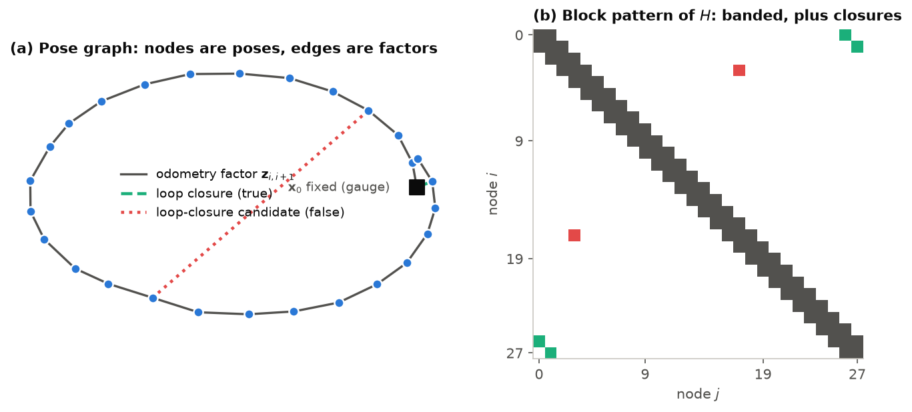
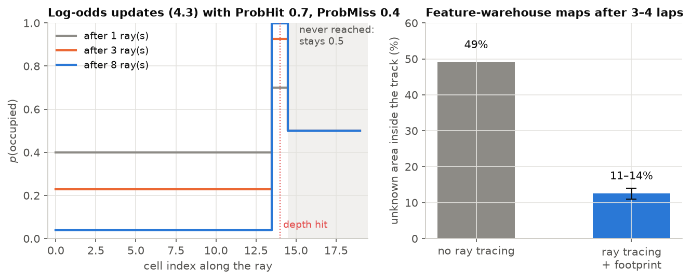

# Lecture 4 — SLAM and Localization

*Notebook:* [04_pose_graph_slam.ipynb](notebooks/04_pose_graph_slam.ipynb)

*Reading:* [Grisetti10]; [Cadena16]; [Labbe19]; [Elfes89]; [Thrun05] ch. 9.

*Further reading:* [Lu97], the origin of pose-graph SLAM; [Kummerle11] for the optimiser SAURCON uses.

## Outcomes

After this lecture you can (i) formulate SLAM as sparse nonlinear least squares over a pose
graph and solve it with Gauss–Newton; (ii) treat loop-closure acceptance as a hypothesis test and
explain why it fails when link uncertainties are wrong; (iii) separate mapping, localization and
global relocalization, and design the `map → odom` correction so that it is consistent in time;
(iv) build occupancy grids with log-odds updates and ray tracing, post-process them with stated,
conservative rules, and explain why mapped landmarks duplicate after loop closures.

## 1. SLAM as a factor graph

RTAB-Map [Labbe19] stores a **node** each time the car has moved enough (at most 2 per second in
SAURCON): the pose estimate $\mathbf x_i$ and the RGB-D frame with its visual words. **Edges**
constrain pairs of nodes with a measured relative pose $\mathbf z_{ij}$ and information matrix
$\Omega_{ij} = \Sigma_{ij}^{-1}$:

- *odometry links* between consecutive nodes, from the odometry filter of L3;
- *loop-closure links* when the current frame matches an earlier node, from visual feature
  matching followed by 3-D registration.

With the error $\mathbf e_{ij}(\mathbf x) = \mathbf z_{ij}\ominus(\ominus\mathbf x_i\oplus\mathbf
x_j)$, the maximum-likelihood map under Gaussian noise minimises

$$
F(\mathbf x) = \sum_{(i,j)\in\mathcal E}\mathbf e_{ij}^\top\Omega_{ij}\,\mathbf e_{ij}. \tag{4.1}
$$

**Gauss–Newton.** Linearise each error at the current estimate,
$\mathbf e_{ij}(\mathbf x\boxplus\Delta)\approx\mathbf e_{ij} + J_{ij}\Delta$, where $\boxplus$
adds increments on the manifold (wrapping angles). Substituting into (4.1) and setting the
gradient to zero gives the normal equations

$$
H\Delta = -\mathbf b,\qquad H = \sum J_{ij}^\top\Omega_{ij}J_{ij},\qquad \mathbf b = \sum J_{ij}^\top\Omega_{ij}\mathbf e_{ij}, \tag{4.2}
$$

iterated to convergence (Levenberg–Marquardt adds a damping term $\mu I$ for robustness). Two
properties make this practical. **Sparsity:** each edge touches two nodes, so $H$ has non-zero
blocks only on the diagonal and at connected pairs; sparse Cholesky solves thousands of poses in
milliseconds [Kummerle11]. **Gauge freedom:** (4.1) depends only on relative poses, so $H$ is
singular until one pose is fixed (anchor the first node).

**Why loop closures matter.** Odometry alone is a chain; its end-point covariance grows without
bound. One closure adds a cycle, and (4.2) distributes the accumulated error around it in
proportion to each link's uncertainty. SAURCON's back end is g2o (`Optimizer/Strategy 1`).

*Figure 4.1.* (a) A drifting two-lap pose graph with odometry factors, two correct loop closures and one false candidate. (b) The block sparsity of $H$ in (4.2): a band from odometry, plus one symmetric pair of blocks per closure; sparse Cholesky exploits exactly this pattern. A false closure (red) adds blocks just like a true one; only the residual test of §2 can tell them apart.

## 2. Accepting a loop closure is a hypothesis test

Visual matches can be wrong, especially in repetitive environments: SAURCON's warehouse has two
long aisles that look alike from opposite directions. A wrong closure, once optimised, drags the
whole map. RTAB-Map therefore re-optimises with the candidate and rejects it if any link's
residual exceeds $k$ standard deviations of that link (`RGBD/OptimizeMaxError`, $k = 3$). This is
a significance test with the null hypothesis "the closure is correct", and like every test it is
only as good as its noise model.

### From the lab: accumulated vs. incremental covariance

RTAB-Map treats the covariance in each odometry message as the uncertainty of *one link*.
SAURCON's filter published its *total* covariance, which grows for the whole run, to metres after
a few minutes. By 139 s RTAB-Map believed each 0.5 m link could be off by metres, and accepted a
closure matching the $y = 4$ aisle (driving $+x$ on a reverse lap) to the $y = 0$ aisle. The map
jumped 4 m sideways (2.3 m RMS error).

Switching RTAB-Map to read odometry from TF with a fixed per-link variance fixed the *model*, but
2 cm per link still let the closure through: the 4 m error spread over ~160 links is about 2.5 cm
each, inside 3σ. The measured drift was under 1 cm per link, so the variance was set to
5 mm and 0.18°. The false closure then failed the test, 114 bad matches were rejected, and the
two-direction map came out at 0.11 m RMS.

**Lesson.** A probabilistic check is only as good as the uncertainties it is given.
"Conservative" (too large) noise is not safe: it disables outlier rejection. Problem 4.2 asks for
the threshold variance analytically.

## 3. Mapping, localization and relocalization

- **Mapping** (`Mem/IncrementalMemory=true`) adds nodes and closures.
- **Localization** (`false`) matches the current view against a saved map without adding nodes
  and publishes `/rtabmap/localization_pose`.
- **Global relocalization** is localization from an unknown pose. In a symmetric environment it
  is ambiguous: SAURCON parked facing $-x$ relocalized to a look-alike place 5 m away facing $+x$.
  RTAB-Map's guard checks a localization against several recent odometry nodes, which cannot
  work while the car is stationary. A known start pose (`initial_pose:=`) avoids the problem, as
  does a real deployment that restarts where it stopped. Multi-hypothesis localization is the
  general answer (problem 4.4).

## 4. The world is part of the sensor

Visual loop closure needs features: corners and texture that can be matched between views
[Shi94; Rublee11]. A new world built for SAURCON (`feature_warehouse.world`) had varied 3-D
geometry but **flat-shaded, untextured surfaces**. The camera found ~100 corners per frame there
against 300–470 in the original warehouse, and RTAB-Map rejected every closure candidate with
"not enough features" (11–37 inliers against a minimum of 20). Odometry alone held the map for one
lap. Adding procedurally generated textures (concrete aggregate, masonry, cardboard and labels;
greyscale, to keep the cone detector's colour band clear) and shadows raised the median to ~640
corners per frame and gave 25–29 accepted closures over three laps, with 0.09 m RMS map error.
**Lesson:** a SLAM system's performance is a property of the sensor *and the environment*;
measure the input (features per frame) before tuning the algorithm, and never loosen the
inlier threshold to compensate for a featureless world.

## 5. Who owns `map → odom`? The dual-filter design

RTAB-Map needs smooth odometry it can trust between nodes; a planner needs a globally correct
pose at high rate. One filter cannot do both without a feedback loop: RTAB-Map's corrections would
return to it as "odometry". SAURCON runs **two instances of the same UKF**:

1. the **odometry UKF** (wheel + gyro) publishes ${}^{O}T_{B}$; RTAB-Map uses it, and it never
   sees RTAB-Map's corrections;
2. the **global UKF** adds RTAB-Map's pose as a latency-compensated measurement (3.7) and
   publishes `/saurcon/nav_state` at 50 Hz and ${}^{M}T_{O}$; RTAB-Map's own `map → odom`
   publishing is off. While mapping, RTAB-Map publishes no localization pose, so the global
   filter uses the newest node of the optimised path (`/rtabmap/mapPath`).

In the marker-free world over two laps: fused UKF 0.070 m RMS, RTAB-Map alone 0.069 m,
odometry alone 0.168 m. The fused filter matches RTAB-Map's accuracy at 25 times its rate.

### From the lab: composing poses from two different instants

The correction is ${}^{M}T_{O} = {}^{M}T_{B}\,({}^{O}T_{B})^{-1}$. The global pose is for *now*;
the newest odometry transform is usually tens of milliseconds older. The original code combined
them anyway. With *perfect* estimates (global $x = 10$ m at $t = 2.0$ s; odometry $x = 9.5$ m at
$t = 1.9$ s; the car at 5 m/s) it published a 0.5 m correction, and once odometry for 2.0 s
arrived, `map → odom → base_link` put the car at 10.5 m. The error is the motion during the lag,
built into the correction. The fix keeps one second of global poses and interpolates them to the
odometry transform's stamp before composing (`map_odom.hpp`); outside the history it publishes
nothing that tick rather than something wrong. **Lesson:** every composition of transforms needs
all its terms at one instant; check stamps, not only frames.

## 6. Occupancy grids

An occupancy grid estimates, for each cell $c$, the probability that it is occupied. Assuming
cells independent and the map static, the Bayes filter (3.1) per cell becomes additive in
**log-odds** $\ell = \log\frac{p}{1-p}$ [Elfes89; Thrun05 ch. 9]:

$$
\ell_c \leftarrow \ell_c + \log\frac{p(c\mid\mathbf z)}{1-p(c\mid\mathbf z)} - \ell_0, \tag{4.3}
$$

where $p(c\mid\mathbf z)$ is the **inverse sensor model**: high for the cell a depth ray ends in
(RTAB-Map's `ProbHit` 0.7), low for cells the ray passed through (`ProbMiss` 0.4), and no update
for cells the ray never reached. Clamping $\ell$ keeps the map able to change. A cell is drawn
occupied, free or unknown by thresholding $p$.

### From the lab: why the map stayed grey

After four laps, half of the area inside the track was still *unknown*. Three causes, in order
of effect: (1) **no ray tracing**: RTAB-Map's default marks cells free only where floor points
land, and a camera 14 cm high sees the floor at a grazing angle, so few points land; with
`Grid/RayTracing` every ray clears the cells it crosses, as (4.3) intends. (2) `Grid/RangeMax` =
4 m ignores anything farther. (3) A forward camera on the racing line sees the same things every
lap, so more laps add little. With ray tracing and the car's footprint marked free, unknown area
inside the track fell from **49% to 11–14%**, at the cost of camera rate under SLAM load (11 →
~9.5 frames/s). **Lesson:** "more data" does not fix a measurement model that discards most of
the data.

*Figure 4.2.* Left: the log-odds update (4.3) along one depth ray. Cells the ray crosses become free with repeated observations, the end cell becomes occupied, and cells beyond the hit are never updated. Without ray tracing only cells where floor points land are updated, which from a camera 14 cm high is few. Right: the measured effect on the feature-warehouse maps.

### Cleaning the grid, and a drivable map from a task prior

Rays from successive nodes do not cover every 5 cm cell, so observed free space is speckled: one
three-lap map had 1,582 single-cell and 203 two-to-four-cell unknown holes inside driven space.
`map_cleaner.py` publishes two derived grids and never alters `/map`:

- `/map_clean`: an unknown region of at most 8 cells whose *every* neighbour is free becomes
  free. Holes touching an obstacle, the map edge or the large unknown area are kept, so no free
  space is invented at the frontier, and occupied cells never change (a lone occupied cell may be
  a cone).
- `/map_drivable`: the task prior "inside the cones is drivable, outside is not". Each mapped cone
  is classified left or right of the driven path; at each path point the corridor spans from the
  right cones to the left ones. Cones facing each other across an infield are never paired,
  because no driven path runs between them; obstacles seen inside the lane stay blocked.

**Lesson.** Post-processing a probabilistic map is legitimate when the rule is stated, testable
and conservative: fill only what is enclosed by evidence, and keep the raw map for anything that
needs it.

## 7. Landmark maps and why they duplicate

`cone_mapper_node.py` places each detected cone in the map frame with RTAB-Map's pose at the time
of the detection and merges detections within a radius. Against ground truth: recall 0.83–0.87,
position error 8–12 cm RMS, but **precision only ~0.5–0.7**: many mapped cones are duplicates.
Each cone is frozen once placed, but a later loop closure corrects the *poses* it was placed
from, so the next sighting lands elsewhere and becomes a new cone. The general remedy is to make
landmarks part of the estimation: attach each to the graph node it was observed from (so it
moves with every optimisation), or add landmarks to (4.1) as variables with their own factors,
which is landmark SLAM proper [Cadena16].

## In SAURCON

| Concept | Where |
|---|---|
| RTAB-Map parameters, TF odometry variance, `initial_pose`, grid settings | `src/saurcon_nav/launch/rtabmap_sim.launch.py` |
| Two filter instances, `fuse_slam` | `src/saurcon_rc/launch/full_sim_saurcon.launch.py` (`estimators`) |
| `map → odom` at a common time | `src/saurcon_nav/src/map_odom.hpp`, test `test/test_map_odom.cpp` |
| Hole filling, drivable map | `src/saurcon_nav/scripts/map_cleaner.py`, test `test/test_map_cleaner.py` |
| Cone map from RTAB-Map poses | `src/saurcon_plan/saurcon_plan/cone_mapper_node.py` |
| Map snapshots, race videos with the map | `scripts/sim_eval/capture_map.py`, `scripts/sim_eval/make_race_video.py` |
| History of results | `docs/RTABMAP_STATUS.md` |

## Summary

- SLAM is sparse nonlinear least squares; loop closures turn a drifting chain into a consistent
  graph.
- Loop-closure acceptance is a statistical test, and its outcome is decided by the link
  covariances you supply.
- The environment is part of the sensor: feature-poor worlds defeat visual SLAM regardless of
  tuning.
- Every transform composition must be evaluated at a single instant.
- Occupancy grids are per-cell Bayes filters; their completeness depends on the inverse sensor
  model (ray tracing), and post-processing must be conservative.

## Problems

**4.1** [C] ★ In notebook 04, remove the loop closure and plot the final pose error against lap
count. Fit the growth law and explain its exponent.

**4.2** [T] ★★ A false closure of magnitude $D$ is spread over $N$ odometry links, each with
standard deviation $\sigma$. Assuming the error distributes evenly, derive the largest $\sigma$
for which a $k\sigma$ per-link test rejects it. Evaluate for $D = 4$ m, $N = 160$, $k = 3$.

**4.3** [T] ★★ Explain why `fuse_slam:=true` must turn off RTAB-Map's `publish_tf`. What would
`tf2_echo map base_link` show otherwise?

**4.4** [T] ★★★ Propose a relocalization method that works while stationary in a symmetric
environment (hint: multiple hypotheses and a decision rule for when to commit). State its failure
probability as a function of the number of look-alike places.

**4.5** [T] ★ Using §5, compute the `map → odom` error from mixing instants for a car at 5 m/s with
40 ms of odometry lag. Then give the error if the car is also yawing at 2 rad/s and the
transform's translation is 3 m from the car.

**4.6** [C] ★★★ Store each mapped cone relative to the RTAB-Map node it was first seen from, and
re-place all cones whenever `/rtabmap/mapPath` changes. Measure precision and recall before and
after over three runs.

**4.7** [S] ★★ Map the track with `Grid/RayTracing` on and off and with `Grid/RangeMax` 4, 6 and
8 m. Report unknown area inside the track and the cone node's camera rate for each, and choose a
setting with a stated trade-off.

**4.8** [T] ★★ `/map_drivable` assumes every cone belongs to a lane boundary. Using the stadium
geometry in `test_map_cleaner.py`, place one cone in the middle of the lane and predict what the
corridor does. Propose and justify a rule that treats it as an obstacle instead.

### Answers to selected problems

**4.2** Per-link error $D/N$ must exceed $k\sigma$, so $\sigma < D/(kN)$. With $D = 4$ m,
$N = 160$, $k = 3$: $\sigma < 8.3$ mm. The 2 cm setting of §2 could not reject it; 5 mm could.

**4.5** Translation error $v\,\Delta t = 0.2$ m. With yaw, the correction is also rotated by
$\dot\psi\Delta t = 0.08$ rad, which moves a point 3 m away by a further ≈ 0.24 m: the error
grows with distance from the rotation centre, which is why a small timing error shows up as a
large one far from the car.
