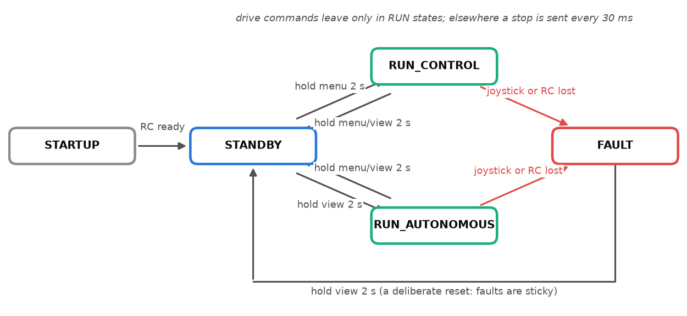

# Lecture 5 — Safety-Critical Vehicle Software

*Reading:* [Leveson11] ch. 1–2 and 8 (STPA); [Koopman16]; [ISO26262] part 1 (vocabulary, skim).

## Outcomes

After this lecture you can (i) derive safety requirements from hazards rather than from
features; (ii) specify mode logic as a state machine with a defined response to every event;
(iii) distinguish liveness monitoring (watchdogs, heartbeats) from input validity checking, and
explain why a system needs both; (iv) test timing-dependent safety logic deterministically,
without hardware.

## 1. From hazards to requirements

Safety engineering starts from what must not happen, not from what the system should do. For
SAURCON the top-level **hazard** is *the car moves when no one intends it to, or moves in a way
no one intends*. Systems-theoretic analysis [Leveson11] asks how each controller in the loop
could issue an unsafe command: provide one that is unsafe, fail to provide one that is needed,
provide it too early or too late, or apply it too long. Applied to the autonomy loop, each answer
becomes a requirement:

| Unsafe control action | Example cause | Requirement |
|---|---|---|
| Drive command continues after the operator lets go | joystick disconnected | dead-man switch: lost joystick ⇒ FAULT (§3) |
| Drive command continues after the planner stops | planner crashed | command age limit ⇒ stop (§3) |
| Drive command computed from stale data | estimator or camera stalled | input validity checks in the planner (§4) |
| Command applied before the car is ready | start-up race | explicit STARTUP state, long-press transitions (§2) |
| Drive command latched across a mode change | stale buffer | clear commands on every transition (§2) |

The table is the specification; the rest of the lecture is its implementation and its tests.

## 2. Mode logic

A car that can be driven by a person, by software, or not at all needs an explicit, small set of
modes with defined transitions. SAURCON's (`saurcon_rc/src/state_machine.cpp`):

```
STARTUP ──(RC reports ready)──► STANDBY
STANDBY ──hold menu 2 s──► RUN_CONTROL      (joystick drives)
STANDBY ──hold view 2 s──► RUN_AUTONOMOUS   (cone follower drives, /auto_cmd)
RUN_*   ──hold menu or view 2 s──► STANDBY
RUN_*   ──heartbeat lost──► FAULT ──hold view 2 s──► STANDBY
```



*Figure 5.1.* SAURCON's mode logic. Every transition into or out of a RUN state needs a deliberate 2 s hold; losing the joystick or the RC heartbeat in a RUN state faults the car, and only a human action leaves FAULT.


The ESP32 runs a matching state machine; the ROS side commands it on `/rc_state_cmd` and listens
on `/saurcon/state`. Drive commands leave on `/ctrl_output` only in RUN states; otherwise a stop
command is published every 30 ms. Design rules:

- **Long presses** (2 s) for every mode change, so a bumped button does nothing.
- **Every transition clears the drive command** and tells the ESP32 immediately, rather than at
  its 1 Hz status rate.
- **Faults are sticky**: leaving FAULT needs a deliberate human action.
- **Totality**: every (state, event) pair has a defined next state and action. Writing the
  machine as a table, not as nested conditionals, makes missing pairs visible (problem 5.1).

## 3. Liveness: watchdogs and heartbeats

| Watchdog | Timeout | Action |
|---|---|---|
| Joystick heartbeat (dead-man) | 1 s | FAULT from any RUN state |
| RC (ESP32) heartbeat | 3 s (status at 1 Hz) | FAULT |
| Autonomous command age | 0.25 s | stop, stay in RUN_AUTONOMOUS |

In autonomy the joystick stays a dead-man switch: if the operator's controller disconnects, the
car stops even though the planner is still sending commands. Timeouts are chosen from the
monitored signal's period with margin (the RC status is 1 Hz, so 3 s tolerates two lost
messages) and from the stopping distance the system can afford (0.25 s at 5 m/s is 1.25 m).

**From the lab: the disabled watchdog.** In the original code the heartbeat check was commented
out. Losing the controller in RUN_CONTROL left the last stick position latched: the car kept
driving at that throttle indefinitely. Re-enabling it required fixing the timestamps it
compared: a default-constructed `rclcpp::Time` has a different clock type from `now()`, and
subtracting the two throws. **Lesson:** watchdogs are code that rarely runs, so test them on
purpose; SAURCON's scripted lap ends with a controller-loss test for this reason.

## 4. Validity: a live publisher with dead inputs

Liveness monitoring detects a *silent* publisher. It cannot detect a publisher that keeps
sending confident commands computed from stale inputs, and every such command resets the
liveness timer. The planner must therefore check its own inputs. The cone follower node
(`saurcon_plan/cone_follower_node.py`) drives only when all of them are valid:

| Input | Valid if | Otherwise |
|---|---|---|
| camera image | *captured* (header stamp) within 0.3 s | zero command, history reset |
| odometry message | stamped within 0.25 s and newer than the last accepted | zero command, history reset |
| `odom → base_link` transform | present and at most 0.25 s old | zero command, cone memory cleared |

**From the lab: the review that found it.** A code review of an earlier driving node (a learned
policy, since removed) found that once it had received one navigation state, it computed and
published commands at 20 Hz forever: it checked only whether a state had *ever* arrived. Had the
estimator crashed, each command would have refreshed the 0.25 s watchdog of §3, and the car would
have driven on a frozen pose. Reproduced with a fake publisher: 200 consecutive commands at
6 m/s from a single stored state. The cone node had the same flaw in subtler forms: it clamped an
arbitrarily old transform's age to 0.2 s, substituted an identity pose when the lookup failed,
and marked an image fresh when it was *processed* rather than when it was *captured*.

Five rules follow, and they are general:

1. **Judge freshness by the data's own timestamp**, never by arrival or processing time.
2. **Refuse stamps that are not newer** than the last accepted one; a replayed message must not
   renew validity.
3. **Stop by publishing zero**, not by going silent, so downstream monitors see a deliberate
   stop rather than a lost link.
4. **Never substitute a default for missing data** (an identity transform, a clamped age).
   Extrapolate only over *bounded*, expected latency.
5. **Reset history on recovery** (previous command, held steering, remembered landmarks), so the
   first command after an outage is not built on pre-outage state.

**The cost of safety is measurable.** Under SLAM load the camera slows to ~9.5 frames/s, and the
0.3 s image rule stops the car for a single 50 ms step on about 6% of steps, costing ~0.3 s per
lap. That is the right default; trading it away is a design decision to be argued with numbers
(problem 5.6), not a tuning convenience.

## 5. Testing timing logic without hardware

Safety logic is a function of time and of its inputs' timestamps, so test it as one: inject a
clock that the test advances, a transform buffer that returns a transform at a chosen stamp or
raises, a controller that would happily drive, and a publisher that records commands. Each test
states one property ("expired odometry ⇒ zero command on every subsequent step") and nothing is
actuated (`src/saurcon_plan/test/test_follower_node.py`). Two disciplines make such tests
trustworthy: confirm each new test **fails on the old code**, and test **recovery** as carefully
as the failure.

## 6. Undefined behaviour in a control loop

`menu_held` and several other members of the original state machine had no initial value and were
read every 30 ms before any joystick message arrived. Depending on stack contents the node could
crash or jump straight to RUN_CONTROL. Give every member a default; compile with warnings and
sanitizers in continuous integration; bounds-check every array that comes from outside
(`Joy.axes`, `JointState.velocity`), because a different gamepad has a different layout.

## In SAURCON

| Concept | Where |
|---|---|
| Mode logic, heartbeats, command age | `src/saurcon_rc/src/state_machine.cpp` |
| Input validity in the planner | `src/saurcon_plan/saurcon_plan/cone_follower_node.py` |
| Timing tests with fakes | `src/saurcon_plan/test/test_follower_node.py` |
| Scripted lap ending in a controller-loss test | `scripts/sim_eval/driver.py` |

## Summary

- Derive requirements from hazards; each unsafe control action needs a mechanism and a test.
- Liveness monitoring and input validity are different properties; a safe system has both.
- Timestamps, not arrival times, decide validity; stop by commanding zero.
- Test timing logic with an injected clock, and prove each test fails on the old code.

## Problems

**5.1** [T] ★ Write the state machine of §2 as a table of (state, event) → (next state,
action) for the events {menu held, view held, joystick lost, RC lost, RC ready}. Which pairs are
unspecified in the diagram, and what should they do?

**5.2** [T] ★ Why is the RC heartbeat timeout 3 s rather than 1 s? Give the trade-off as a
false-fault probability versus a worst-case undetected-failure duration, for a 5% message loss
rate.

**5.3** [T] ★★ The command-age timeout stops the car but does not fault it. Argue for and against
faulting instead, using the hazard table of §1.

**5.4** [C] ★★ Write a unit test that drives the state machine through STANDBY → RUN_AUTONOMOUS →
(joystick lost) → FAULT → STANDBY with an injected clock.

**5.5** [C] ★ Read `test_follower_node.py`. Add a test that an image delivered *after* a newer one
(out-of-order delivery) cannot make the camera input fresher than it is, and that the node still
stops on time.

**5.6** [T] ★★ The 0.3 s image rule stops the car for one step on ~6% of steps under SLAM load.
Propose a rule that keeps the safety property but avoids stop-start driving (hint: what does the
car do between two images anyway?). State the hazard it introduces and how you would test it.

**5.7** [T] ★★★ The micro-ROS link can drop packets and the Pi can crash mid-command. Design the
ESP32-side behaviour so the car is safe in both cases, and list the assumptions your design
makes about the ESP32 itself.

### Answers to selected problems

**5.2** With independent 5% loss, a 1 s timeout at 1 Hz faults whenever one message is lost
(about 5% of seconds, many false faults per run); 3 s needs three consecutive losses
($1.25\times10^{-4}$ per window). The price is up to 3 s of undetected RC failure, acceptable only
because the RC side has its own stop-on-silence (problem 5.7).

**5.6** One sound answer: allow driving on the cone memory for a bounded interval after the last
image (say 0.5 s), at a speed reduced so that the car can stop within the path it last saw. The
new hazard is driving on stale cones; it is bounded by the memory's odometry drift and the speed
cap, and it is testable with the same fake clock.
