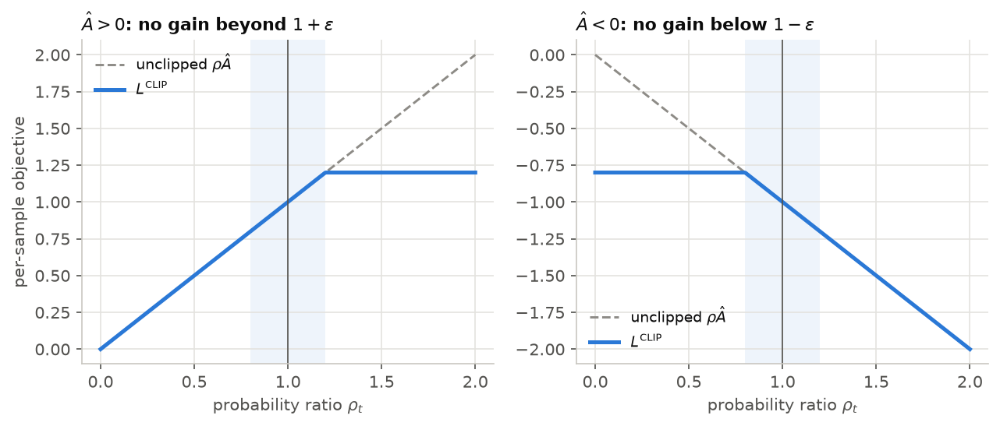

# Lecture 6 — Reinforcement Learning for Racing

*Notebook:* [05_rl_racing.ipynb](notebooks/05_rl_racing.ipynb)

*Reading:* [Sutton18] ch. 3 and 13; [Schulman16]; [Schulman17]; [Ng99]; [Tobin17]; [Henderson18].

## Outcomes

After this lecture you can (i) formulate racing as a Markov decision process and defend each
design choice; (ii) derive the policy-gradient theorem, generalised advantage estimation and
PPO's clipped objective; (iii) design rewards and terminations that optimise lap time without
exploitable shortcuts, using potential-based shaping where shaping is needed; (iv) use a fast
surrogate simulator with domain randomisation, and evaluate learned policies with the statistical
care that single-seed RL results lack; (v) decide, on evidence, whether a learned policy should
drive the real system.

## 1. Racing as an MDP

| Element | SAURCON choice |
|---|---|
| Observation $o_t$ (31) | speed, yaw rate, steering, previous action; lateral offset and heading error from the centreline; 12 centreline points 0.5–15 m ahead, in $\{B\}$ |
| Action $a_t$ (2) | speed command 0–12 m/s, steering angle $\pm\delta_{\max}$, both scaled to $[-1,1]$ |
| Step | $\Delta t = 50$ ms |
| Reward $r_t$ | metres of progress along the centreline, minus $0.02\lVert a_t-a_{t-1}\rVert^2$ |
| Termination | leaving the cone corridor or exceeding the friction ellipse (1.9), with $r = -10$ |
| Episode | random track (racetrack or basement, either direction), random start, 45 s |

The design choices encode prior knowledge. *Body-frame lookahead points*, not absolute position,
make the policy learn "a left bend 4 m ahead", which transfers across tracks. *Progress reward*
makes the discounted return increase with speed; a lap bonus alone would be too sparse to learn
from. *Termination* removes all future reward, a large implicit penalty that scales with how good
the policy already is. The observation includes the previous action because the plant has
actuator dynamics (1.4): without it the problem is not Markov in the observation.

## 2. Policy gradients

For a stochastic policy $\pi_\theta(a\mid s)$ and trajectories $\tau$, the objective is
$J(\theta) = \mathbb E_{\tau\sim\pi_\theta}\big[\sum_t\gamma^t r_t\big]$. Since
$\nabla_\theta p_\theta(\tau) = p_\theta(\tau)\nabla_\theta\log p_\theta(\tau)$ and the dynamics
do not depend on $\theta$, $\nabla_\theta\log p_\theta(\tau) = \sum_t\nabla_\theta\log
\pi_\theta(a_t\mid s_t)$. Causality (an action cannot affect earlier rewards) and the fact that
any action-independent baseline has zero expected gradient give the **policy-gradient theorem**
[Williams92; Sutton00]:

$$
\nabla_\theta J = \mathbb E\Big[\sum_t\nabla_\theta\log\pi_\theta(a_t\mid s_t)\,A^\pi(s_t,a_t)\Big],\qquad
A^\pi(s,a) = Q^\pi(s,a) - V^\pi(s). \tag{6.1}
$$

The **advantage** says how much better $a_t$ was than the policy's average action in $s_t$.
Estimating it well is the whole game.

**Generalised advantage estimation.** With a learned value $V_\phi$, the TD residual
$\delta_t = r_t + \gamma V_\phi(s_{t+1}) - V_\phi(s_t)$ is an unbiased advantage estimate if
$V_\phi = V^\pi$, but biased otherwise; the Monte-Carlo return is unbiased but high-variance.
GAE [Schulman16] takes an exponentially weighted average of the $k$-step estimators:

$$
\hat A_t^{\text{GAE}(\gamma,\lambda)} = \sum_{l\ge0}(\gamma\lambda)^l\,\delta_{t+l}. \tag{6.2}
$$

$\lambda = 0$ is the one-step TD estimate (low variance, biased); $\lambda = 1$ is the
Monte-Carlo advantage (unbiased, high variance). SAURCON uses $\gamma = 0.99$, an effective
horizon $1/(1-\gamma) = 100$ steps or 5 s, enough to plan braking for a bend, and $\lambda = 0.95$.

## 3. Proximal policy optimisation

A gradient step of (6.1) is valid only near the data-collecting policy; large steps on stale data
collapse performance. PPO [Schulman17] maximises a clipped surrogate in the probability ratio
$\rho_t(\theta) = \pi_\theta(a_t\mid s_t)/\pi_{\theta_\text{old}}(a_t\mid s_t)$:

$$
L^{\text{CLIP}}(\theta) = \mathbb E\Big[\min\big(\rho_t\hat A_t,\ \operatorname{clip}(\rho_t,1-\epsilon,1+\epsilon)\,\hat A_t\big)\Big]. \tag{6.3}
$$

For a positive advantage the objective stops increasing once $\rho_t > 1+\epsilon$; for a negative
one, once $\rho_t < 1-\epsilon$. The minimum makes the bound pessimistic, so there is no incentive
to move the policy far from the one that collected the data ($\epsilon = 0.2$). Each iteration,
12 parallel environments collect 1,024 steps each; 10 epochs of minibatch (4,096) gradient steps
optimise (6.3) together with a value loss and an entropy bonus; actions are sampled from a
Gaussian in training and its mean is used in evaluation [Raffin21].

*Figure 6.1.* The clipped surrogate (6.3) for one sample with $\epsilon = 0.2$. When the advantage is positive, raising the action's probability stops paying beyond $1+\epsilon$; when it is negative, lowering it stops paying below $1-\epsilon$. Moves in the harmful direction are never clipped, so the bound is pessimistic.

## 4. Rewards and terminations

**Shaping without changing the optimum.** Adding $F(s,s') = \gamma\Phi(s')-\Phi(s)$ for any
potential $\Phi$ leaves the optimal policy unchanged [Ng99]. Progress along the centreline is
exactly such a term with $\Phi$ = arc length, which is why it can be dense without biasing the
racing line. Penalties that are *not* potential-based (the action-smoothness term) change the
optimum; keep them small and measure their effect.

**Reward hacking to anticipate.** Progress measured as arc length could be gamed by jumping
across the infield if projection were global; projecting within a search window around the last
index prevents it. In the cone-vision variant of L9, training twice converged on *parking*:
standing still earns zero and never crashes, which beat driving into unseen cones. Terminating
with the crash penalty after 2 s below 0.3 m/s fixed it. A per-step time penalty is the obvious
alternative but is worse here: over a 45 s episode it exceeds the crash penalty, so crashing early
would score better than driving carefully. **Make degenerate behaviour exactly as bad as the
failure you fear.**

## 5. Sim-to-sim transfer and domain randomisation

Gazebo with a rendered camera runs at about real time, so 20 M training steps (~280 h of driving)
are impossible there. The method is the one used in sim-to-real work [Tobin17; Peng18]:

1. **Identify** the target (L1) and build a fast model (~5,800 steps/s per core).
2. **Randomise** what you are unsure of, so the policy cannot overfit one car: grip
   8.5–10.5 m/s², acceleration 3.5–4.5, braking 4–5, steering lag 0.1–0.3 s, pose noise up to
   5 cm, sensing delay up to 60 ms.
3. **Validate** in a higher-fidelity simulator, here MuJoCo (L8), which models the contact
   effects the bicycle model omits.

**Results (single seed, 20 M steps, ~1 h on 12 cores).** The flying lap fell from 22.5 s at
0.25 M steps to **7.35 s** (best, at 18.5 M), top speed rising from 2.4 to 9.9 m/s, with no crash
in 80 evaluation laps; standing start 8.35 s. The centreline bound of Algorithm 1.1 is 7.80 s: the
policy beats it by using the corridor for wider lines, accelerating earlier and braking later,
while being *slower* in the bends (2.9 vs 4.4 m/s), because it was trained against grip as low as
8.5 m/s² and steering lag up to 0.3 s. Robustness costs speed, and randomisation ranges decide how
much. These results are for the original 1.2 m gates (a ±0.44 m corridor); the racetrack now has
2.2 m gates (±0.94 m), and the policies have not been retrained on it.

**How much should you believe a single-seed result?** Little. RL outcomes vary widely with the
seed, and published comparisons are often within that variation [Henderson18]. Report at least
five seeds, the interquartile mean and a bootstrap confidence interval [Agarwal21], and evaluate
under the conditions the policy will meet (L9 §4 shows a policy that "crashed" only because its
evaluation disabled the noise it was trained with).

## 6. From the lab: the first full-speed race in Gazebo

Early in the project, policies were also raced in the full Gazebo loop through a ROS node. A policy
trained to 3 m/s transferred almost perfectly (16.3 s in Gazebo vs 16.25 s in training). The
7.35 s policy did not: on its first lap it reached the far bend at ~9 m/s, braked, and spun.
Comparing estimated and true pose through the crash showed two model errors, neither visible at
low speed:

1. **Wheel spin corrupted odometry.** Gazebo's drive ramped the rear wheels at 5 m/s², above the
   ~4.1 m/s² the tyres can transmit. The wheels spun, odometry over-read speed by up to 1 m/s, and
   between 2 Hz SLAM fixes the estimate ran up to 1 m ahead of the car.
2. **Braking and cornering share grip.** The training model limited only lateral acceleration;
   Gazebo's car brakes with the rear wheels only, and braking hard into the bend let the rear go.

The fix was physical, not a reward hack: ramp limits just under tyre grip (as a traction-controlled
drive would have), and the friction ellipse (1.9) in the training model. **The corrected model
reproduced the failure**: the old policy spun 8.9 m into its first braking zone, as in Gazebo.
That reproduction is the evidence that the model captures what went wrong; a fix that cannot
reproduce the failure is a guess. A second lesson: the crash stalled Gazebo's physics
(real-time factor 1%), which fired the state machine's command timeout continuously; the first
diagnosis, "the machine was busy", was wrong and was caught only by profiling the real-time factor
over the run. **Measure before explaining.**

## 7. Should a learned policy drive?

SAURCON's car is driven by the classical cone follower (L9); the learned policies are trained and
evaluated in simulation only. The decision rests on evidence that generalises to any learned
controller:

1. **Performance on the deployed task.** On the cone track, the best learned cone policy lapped
   Gazebo in ~31.8 s with a 0.5 m weave; the classical follower lapped in ~12.5 s with a 0.04 m
   weave and transferred from MuJoCo without tuning (L9 §8).
2. **Interface hazards.** A review of the deployment found the map-based policy node would keep
   commanding full speed on a frozen pose if the estimator died (L5 §4), and that its pose was
   converted with the wrong origin under one localization mode: two modes publish a frame called
   `map` with origins 1.127 m apart. A frame name does not tell you its origin.
3. **Dependence on global state.** The map-based policy needs correct localization at every step;
   the cone follower needs only a few seconds of odometry.

A learned policy earns deployment by clearing a stated bar: the same observation as in training
(including latency and actuator limits), explicit frames and origins, input-validity checks (L5),
and a **measured margin over the classical baseline** on the same tracks, over enough seeds and
laps to bound the failure rate (L7 §5). The MuJoCo tools exist to earn that margin:
`saurcon_rl.cone_drive` races a learned policy and the classical follower on identical rendered
pixels through the same detector.

## In SAURCON

| Concept | Where |
|---|---|
| Environment, observation, reward, randomisation | `src/saurcon_rl/saurcon_rl/env.py` |
| Higher-fidelity environment | `src/saurcon_rl/saurcon_rl/mujoco_env.py` (L8) |
| PPO training, lap evaluation | `src/saurcon_rl/saurcon_rl/train.py` |
| Track geometry, car parameters | `src/saurcon_plan/saurcon_plan/track.py`, `vehicle.py` |

## Summary

- The policy gradient weights log-likelihood gradients by advantages; GAE trades bias for
  variance with one parameter; PPO keeps updates where the data are valid.
- Dense rewards should be potential-based; degenerate behaviours must be made as bad as failure.
- Randomise what you do not know, validate in a better simulator, and report over seeds.
- Deployment is a decision with a bar: equal conditions, explicit interfaces, safety checks, and
  a measured margin over the baseline.

## Problems

**6.1** [T] ★ Compute GAE by hand for a 3-step episode with given rewards and values (the
notebook checks your answer). Show that $\lambda = 1$ recovers the Monte-Carlo advantage.

**6.2** [T] ★★ Prove that subtracting a baseline $b(s_t)$ in (6.1) leaves the gradient unbiased.
Then show that the variance-minimising constant baseline is not $\mathbb E[R]$ in general.

**6.3** [T] ★★ Prove the shaping result of [Ng99] for a finite MDP: with
$F = \gamma\Phi(s')-\Phi(s)$, every policy's return changes by $-\Phi(s_0)$.

**6.4** [C] ★ Train with the smoothness penalty set to 0. Measure the steering activity (mean
$|\Delta\delta|$ per step) and lap time in MuJoCo against the baseline, over three seeds.

**6.5** [C] ★★ Remove domain randomisation and retrain. Compare bicycle-model and MuJoCo lap
times and failure rates over five seeds, with bootstrap confidence intervals.

**6.6** [T] ★★ Change the reward to "−1 per step until the lap is complete". Explain why learning
stalls, in terms of the advantage signal early in training.

**6.7** [T] ★★★ Write the acceptance test a learned policy must pass before replacing the classical
follower on the car (§7): tracks, seeds, laps, the margin, the failure rate bound and its
confidence, and which single failures disqualify it outright.

### Answers to selected problems

**6.2** $\mathbb E_a[\nabla\log\pi(a\mid s)\,b(s)] = b(s)\nabla\sum_a\pi(a\mid s) = b(s)\nabla 1 = 0$.
For a scalar parameter the variance-minimising constant is
$b^* = \mathbb E[g^2R]/\mathbb E[g^2]$ with $g = \nabla\log\pi$, a gradient-magnitude-weighted
mean of returns.

**6.3** The shaped return is $\sum_t\gamma^t(r_t + \gamma\Phi(s_{t+1})-\Phi(s_t))$; the potential
terms telescope to $\lim_T\gamma^T\Phi(s_T)-\Phi(s_0) = -\Phi(s_0)$ for bounded $\Phi$. The change
does not depend on the policy, so the ordering of policies, and the optimum, is unchanged.
