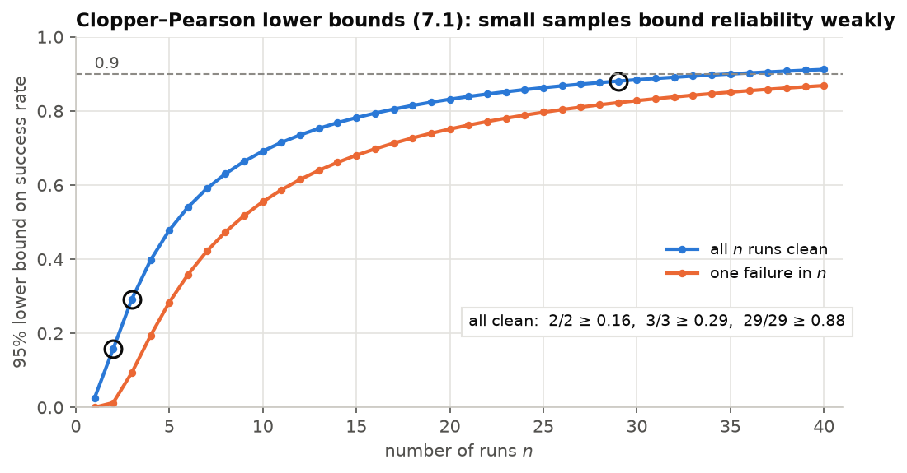

# Lecture 7 — Experimental Method

*Reading:* [Zhang18]; [Sturm12]; [Henderson18]; [Agarwal21]; [Montgomery17] ch. 1–2.

## Outcomes

After this lecture you can (i) align estimated trajectories to ground truth correctly and compute
absolute and relative trajectory errors; (ii) design runs that are isolated and reproducible;
(iii) attach confidence intervals to reliability claims from a handful of trials, and compute how
many trials a claim needs; (iv) write a results section that a sceptical reader can check.

## 1. Ground truth and alignment

Simulation gives exact ground truth (`/world/<name>/dynamic_pose/info`). SAURCON's
`gt_bridge.py` republishes the car's pose *with the simulator's timestamp*; the standard bridge
dropped timestamps, which made early comparisons wrong by the message latency. Check that the
reference point matches: ground truth is the model origin, 0.127 m ahead of `base_link`;
forgetting the offset is a 13 cm error at every sample, and more in turns.

Estimates live in their own frames (`odom`, `map`). To compare them with ground truth, apply **one
rigid transform** $T_\text{align}\in SE(2)$, fixed from information available at the start: the
first shared pose, or, for localization in an existing map, the alignment computed for the
mapping run. **Never** fit $T_\text{align}$ to minimise error over the whole trajectory: a
best-fit alignment absorbs initialisation errors and drift into the transform and reports them
as accuracy. (Best-fit alignment, e.g. Umeyama's method, has its place when comparing shapes of
trajectories from different frames [Zhang18]; it answers a different question.)

## 2. Metrics

With aligned estimates $\hat{\mathbf p}_k$ and ground truth $\mathbf p_k$ at matched times:

- **Absolute trajectory error** $\text{ATE}_\text{RMS} = \big(\tfrac1N\sum_k\|\hat{\mathbf p}_k -
  \mathbf p_k\|^2\big)^{1/2}$, plus the maximum. It measures global consistency and depends on
  the alignment.
- **Relative pose error** over a distance or time $\Delta$: the error of
  $\ominus\hat{\mathbf x}_k\oplus\hat{\mathbf x}_{k+\Delta}$ against the same for ground truth
  [Sturm12]. It measures drift and is alignment-free; report it for several $\Delta$.
- **Heading RMS**, with angles wrapped.
- **Coverage**: the duration actually observed and the largest gap between samples. A short
  surviving segment with good RMS is a failure, not a result: SAURCON's visual-odometry fallback
  once "scored" 4 m RMS on 7 s of a 47 s lap.
- **Consistency**: NEES/NIS against their χ² bounds (L3 §5).
- For racing: standing and flying lap times, **completion** (laps finished out of laps
  attempted), cones disturbed (`cone_watch.py`), and the fraction of control steps stopped by
  safety checks.

Define the scoring window before looking at the numbers: driving only, not the parked warm-up or
the controller-loss test at the end.

## 3. Isolation and reproducibility

Every run in `scripts/sim_eval/runsim.sh` uses a fresh output directory (it refuses to overwrite),
takes a workspace lock so two evaluations cannot overlap, sets a unique `GZ_PARTITION` and
`ROS_DOMAIN_ID`, records the world file in `environment.txt`, starts each component in its own
process group, and cleans up only those groups. Each of these exists because its absence once
produced a plausible but wrong result:

- a failed launch left a second Gazebo running, whose topics merged with the next run;
- killing `ros2 run` left the node processes alive, doubling every TF message;
- a cleanup with `pkill -f <pattern>` killed the shell running it, because the shell's own command
  line matched, and on another occasion ended a training run whose wrapper matched.

**Kill by recorded process ID or process group, never by pattern**, and start children that must
not outlive their parent with `PR_SET_PDEATHSIG`. Keep raw logs and exact command lines
(`environment.txt`, `launch.log`, `log.csv`) with every result, so any number can be regenerated.

## 4. Testing safety logic without the robot

Watchdogs and validity checks run rarely and fail silently. Test them as functions of time with
every collaborator faked: a clock the test advances, a transform buffer that returns a transform
at a chosen stamp or raises, a controller that would happily drive, and a publisher that records
commands (`src/saurcon_plan/test/test_follower_node.py`; L5 §5). Each test states one property;
nothing is actuated; and each new test is first run against the old code to confirm it fails.

## 5. Statistics of small samples

Robotics experiments are expensive, so claims are usually made from a handful of runs. The
numbers are still informative if their uncertainty is reported.

**Reliability.** With $k$ successes in $n$ independent trials, the exact (Clopper–Pearson) 95%
interval for the success probability $p$ is

$$
\Big[\,B^{-1}\big(0.025;\,k,\,n-k+1\big),\ B^{-1}\big(0.975;\,k+1,\,n-k\big)\Big], \tag{7.1}
$$

where $B^{-1}(q; a, b)$ is the $q$-quantile of a Beta$(a,b)$ distribution (with the lower limit
0 if $k = 0$ and the upper limit 1 if $k = n$). Some values worth remembering:

| Result | 95% interval for $p$ |
|---|---|
| 1 of 3 runs clean | [0.008, 0.91] |
| 2 of 2 | [0.16, 1] |
| 3 of 3 | [0.29, 1] |
| 29 of 29 | [0.88, 1] |

*Figure 7.1.* The 95% Clopper–Pearson lower bound on the success rate after $n$ clean runs (blue) and after one failure in $n$ (orange). A handful of clean runs supports only a weak claim; about 29 consecutive clean runs are needed before the bound reaches 0.9.

"Two clean runs out of two" therefore supports only that $p$ is probably not tiny. With zero
failures in $n$ trials, the 95% upper bound on the failure rate is about $3/n$ (the *rule of
three*), so claiming 90% reliability with 95% confidence needs about 29 consecutive clean runs.

**Continuous metrics.** Report the mean with a $t$-interval (or a bootstrap interval for skewed
quantities such as lap time), not the best run. For learned policies, report across training
seeds: at least five, with the interquartile mean and a bootstrap interval [Agarwal21]. Seeds are
the dominant source of variance in deep RL [Henderson18].

**Comparisons.** Pair trials when you can (same seed, same track, same start) and analyse the
paired differences: pairing removes shared variance and needs fewer runs. Change one factor at a
time, or use a factorial design if interactions matter [Montgomery17].

## 6. Reporting

A results section a sceptical reader can check states:

1. **What was run**: commit, world, launch arguments, number of runs and seeds.
2. **What was measured**, over which window, against which ground truth and alignment.
3. **Every outcome**, including failures, as counts with intervals (7.1).
4. **What was not tested**: here, no physical-car validation, and simulated depth that is cleaner
   than real stereo.
5. **Which earlier results a newly found bug affects.** When the cone node was found to pair each
   colour image with the previous depth frame (L9 §4), every earlier cone result obtained through
   it had to be flagged.

Reliability is a count, not an anecdote: the classical follower with SLAM running was first clean
in 1 of 3 runs. Reporting only the clean run's lap times would have hidden the two bugs that the
failures led to.

## In SAURCON

| Concept | Where |
|---|---|
| Isolated runs, environment capture | `scripts/sim_eval/runsim.sh` |
| Ground truth with simulator stamps | `scripts/sim_eval/gt_bridge.py` |
| World-aware start line, spawn and map origin | `scripts/sim_eval/world_info.py` |
| Alignment, ATE, coverage, plots | `scripts/sim_eval/analyze.py` |
| Cone disturbance | `scripts/sim_eval/cone_watch.py` |

## Summary

- Align once, from information available at the start; never fit the alignment to the errors.
- ATE measures consistency, RPE measures drift; report coverage with both.
- Isolation failures produce plausible wrong numbers; engineer them out.
- Small samples are informative only with intervals; "n of n" bounds reliability weakly.

## Problems

**7.1** [C] ★ Score one run twice: with first-pose alignment and with a least-squares
trajectory fit. Explain the difference and which question each answers.

**7.2** [T] ★ Derive the rule of three from (7.1) with $k = n$.

**7.3** [C] ★★ Repeat the marker-free UKF run with 5 seeds. Report the mean ATE with a
$t$-interval. Is the single-run claim of L4 §5 (0.070 m) still supported?

**7.4** [T] ★★ How many paired runs are needed to detect a 0.3 s lap-time improvement with 80%
power, if paired differences have a standard deviation of 0.4 s?

**7.5** [C] ★★ Write a check that fails a run if more than one `gz sim` process is alive at its
start, and add it to `runsim.sh`.

### Answers to selected problems

**7.2** With $k = n$ the lower limit solves $p^n = 0.05$ for a one-sided bound, i.e.
$p = 0.05^{1/n}$; the failure-rate bound is $1-0.05^{1/n} = 1-e^{\ln 0.05/n}\approx 3/n$ since
$-\ln 0.05\approx 3$.

**7.4** For a paired $t$-test, $n\approx\big((z_{0.975}+z_{0.8})\,\sigma/\Delta\big)^2 =
\big((1.96+0.84)\cdot0.4/0.3\big)^2\approx 14$ pairs (slightly more with the $t$ correction).
