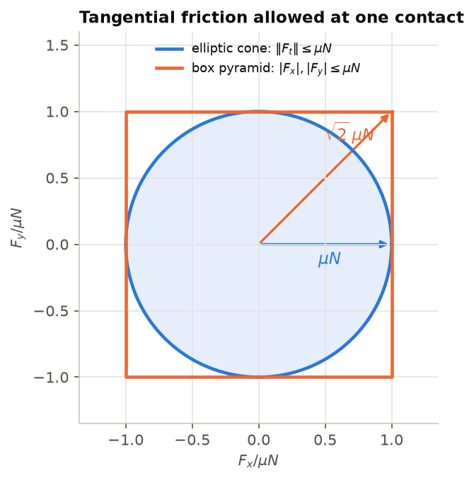

# Lecture 8 — Physics Simulation with MuJoCo

*Notebooks:* [06_mujoco_fundamentals.ipynb](notebooks/06_mujoco_fundamentals.ipynb),
[07_mujoco_sim_to_sim.ipynb](notebooks/07_mujoco_sim_to_sim.ipynb)

*Reading:* [Todorov12]; [Todorov14]; [Koenig04]; MuJoCo documentation, "Computation" chapter.

## Outcomes

After this lecture you can (i) read and write MJCF models, including actuators, defaults and
collision filtering; (ii) state the equations MuJoCo solves, explain its soft-contact model as a
convex optimisation, and relate `solref`, `solimp` and `condim` to physical behaviour; (iii) model
a wheeled vehicle whose rolling contact is stable and whose actuators behave like the real
drive; (iv) calibrate one simulator against another with a defensible metric, and use a
higher-fidelity simulator to predict failures of a policy trained in a lower-fidelity one.

## 1. Choosing a simulator

| Simulator | Speed (control steps/s/core) | Models | Role in SAURCON |
|---|---|---|---|
| Kinematic bicycle (`env.py`) | ~5,800 | kinematics, actuator rates, a friction rule | fast RL experiments |
| MuJoCo (`mujoco_env.py`) | ~1,000 | rigid bodies, tyre contact, weight transfer, slip | RL training and evaluation |
| Gazebo (`full_sim`) | ~20 (real time, rendered sensors) | physics, camera, IMU, ROS 2, SLAM, state machine | the driving stack and its validation |

MuJoCo (Multi-Joint dynamics with Contact) [Todorov12] is built for control and learning: fast,
deterministic, with smooth contact dynamics and analytical derivatives, but no ROS integration or
realistic sensor pipeline. Gazebo [Koenig04] is the opposite trade. Neither replaces the other.
In SAURCON, **reinforcement learning happens only in the first two** (`saurcon_rl`, no ROS), and
**Gazebo runs the ROS driving stack** with the classical cone follower (`saurcon_plan`). The
follower's core needs no ROS, so it also races in MuJoCo against learned policies on identical
rendered pixels (`python -m saurcon_rl.cone_drive --model classical`). The question to ask of any
simulator is not "is it accurate?" but "does it reproduce the effects that decide my outcome?"
§6 gives an example where the answer separated two simulators.

## 2. The equations MuJoCo solves

MuJoCo works in **generalised coordinates** $q$ (positions, including a 7-number free joint for
the chassis: position and unit quaternion) and velocities $v$ (6 for the free joint). The
equations of motion are

$$
M(q)\,\dot v + c(q, v) = \tau + J(q)^\top f, \tag{8.1}
$$

with joint-space inertia $M$, bias forces $c$ (Coriolis, centrifugal, gravity), applied forces
$\tau$ (actuators, passive springs and dampers) and constraint forces $f$ acting through the
constraint Jacobian $J$ (contacts, joint limits, equality constraints).

**Contact as convex optimisation.** Rigid contact is a complementarity problem: forces only push,
and only when bodies touch. MuJoCo instead finds constraint forces by a *convex* optimisation, a
soft version of Gauss's principle of least constraint [Todorov14]: the constrained acceleration
is the one closest, in the metric $M$, to the unconstrained acceleration
$\dot v_0 = M^{-1}(\tau - c)$, subject to a soft penalty for violating the constraints. Each
constraint is pulled toward a *reference acceleration*

$$
\dot v_\text{ref} = -b\,(Jv) - k\,r, \tag{8.2}
$$

where $r$ is the constraint violation (penetration) and $(b, k)$ are a damper and spring
specified by `solref` as a time constant and damping ratio; `solimp` sets how strongly, as a
function of penetration, the constraint is enforced. The result is smooth, unique and fast to
compute, at the price of small, tunable penetration.

**Friction.** Contacts have `condim` dimensions: 1 (frictionless), 3 (sliding friction),
4 (plus torsional), 6 (plus rolling). Wheels use 4. The friction cone may be elliptic or
approximated by a pyramid, and when two geoms touch MuJoCo uses the larger of their friction
coefficients by default.

**Integration.** `implicitfast` treats velocity-dependent forces (damping, velocity actuators)
implicitly, which keeps stiff drives stable at larger steps. SAURCON uses a 2 ms step, 25 physics
steps per 50 ms control step.

## 3. Modelling a car in MJCF

```xml
<mujoco model="saurcon_raceway">
  <option timestep="0.002" integrator="implicitfast"/>
  <default> <default class="wheel"> <geom type="ellipsoid" condim="4" .../> </default> </default>
  <worldbody>
    <geom name="floor" type="plane" .../>
    <body name="car" pos="0 0 0.006">
      <freejoint/>                                      <!-- 6 DoF chassis -->
      <geom name="chassis" type="box" mass="4.0" contype="0" .../>
      <site name="base_link" pos="-0.127 0 0.037"/>      <!-- a frame, no physics -->
      <body name="left_rear_wheel" ...>
        <joint type="hinge" axis="0 1 0"/>               <!-- 1 DoF -->
        <geom class="wheel" mass="0.3"/>
      </body> ...
    </body>
  </worldbody>
  <actuator>
    <velocity joint="left_rear_spin" kv="1" forcerange="-2 2"/>
    <position joint="left_steer" kp="4"/>
  </actuator>
</mujoco>
```

- **Bodies** form a kinematic tree; **joints** add degrees of freedom relative to the parent;
  **geoms** carry shape, mass and contact properties (inertia is computed from them); **sites**
  are named frames (our `base_link`).
- **Actuators** map controls to generalised forces: `motor` (torque), `position`
  ($\tau = k_p(u-q)$), `velocity` ($\tau = k_v(u-v)$), with optional `forcerange`.
- **Collision filtering**: geoms collide when `(contype₁ & conaffinity₂) || (contype₂ &
  conaffinity₁)`. The chassis never touches the floor; the wheels do; cones touch everything.
  Visual-only geometry (`contype="0"`, zero density) can make the model look like the real car
  without changing its physics.

SAURCON generates the MJCF in Python (`mujoco_model.py`) so geometry lives in one place and the
cones come from the same world files as Gazebo. The drive replicates Gazebo's `AckermannSteering`
plugin: the commanded speed is ramped at the acceleration and braking limits, each rear wheel gets
a velocity target with the plugin's differential, and the knuckles get Ackermann angles (1.1).
The cone environment adds the **servo slew limit** (8 rad/s): model the actuator you will have, or
the policy learns to use one you do not.

## 4. From the lab: the hopping car and the wrong culprit

In the first model the car accelerated to 7 m/s, then its wheel contacts flickered between 0, 4
and 8, the chassis lifted and it tumbled. Two changes fixed it at once: cylinder wheels became
ellipsoids, and the drive's velocity gain fell from 5 to 1. The cylinder got the blame. Testing
all four combinations afterwards (notebook 06) showed the opposite: with gain 1 both shapes roll
perfectly; with gain 5 *both* fail, the ellipsoid car worst (it leapt 156 mm). The cause was the
drive: a velocity actuator with a high gain on a very light wheel saturates between its ±2 N·m
limits every step, and the oscillating torque makes the car hop. **Change one variable at a time,
or test each change separately before writing down why something works.** (Ellipsoids were kept:
they give a single smooth contact point.)

## 5. Calibrating one simulator against another

**Engines differ.** Gazebo's ODE-based physics approximates the friction cone with a pyramid,
which permits more horizontal force in diagonal directions. With the same nominal $\mu = 1.0$,
Gazebo's car cornered at ~10 m/s² and MuJoCo's at ~7.5 m/s². A parameter does not mean the same
thing in two simulators; **calibrate behaviour, not parameters.**



*Figure 8.1.* Tangential force allowed at one contact with the same nominal $\mu$: an elliptic friction cone and a box-shaped pyramid approximation (Gazebo's ODE). The pyramid admits up to $\sqrt2\,\mu N$ along its diagonals, one reason the same $\mu$ gave Gazebo's car more grip.

Calibration is an identification problem (L1 §5) with the other simulator as the plant. Run the
same identification drive in both (`sysid.py` and `sysid.py --mujoco`), choose a metric, and
optimise. A sweep scored on the steady 2–3 m/s rows of the grip test gave RMS lateral-acceleration
errors of 1.40, **0.72**, 0.87 and 1.24 m/s² for $\mu$ = 1.2, **1.4**, 1.6, 1.8. The first attempt
scored all rows, including those where both cars were spinning, and preferred 1.8: **the metric
decides the answer**, so it must measure the regime that matters. $\mu = 1.4$ also sits slightly
under Gazebo's grip on average, the safe side for training. In training, MuJoCo randomises friction
×0.85–1.05 and mass ×0.9–1.1 on top of the bicycle model's randomisation (L6 §5).

## 6. A simulator that predicts a failure

A policy fine-tuned in the bicycle model with a friction-circle rule lapped cleanly there (7.6 s).
In MuJoCo it spun on the straight before the first bend: with only 0.04 rad of steering while
braking at 6.7 m/s, the yaw rate reached 1.5–2 rad/s, nearly double the kinematic value
$v\tan\delta/L$. This is **brake-induced oversteer**: only the rear wheels brake, their grip is
spent, and the rear steps out. The bicycle model cannot represent it, because it has no axle
loads. Raced in Gazebo, the same policy spun on its first lap.

| Policy | Bicycle model | MuJoCo | Gazebo full loop |
|---|---|---|---|
| Original (lateral grip only) | spins at 8.9 m | spins at 12 m | spun in the far bend |
| Fine-tuned with friction circle | 7.6 s lap, clean | spins at 12 m | spun at the end of the first bend |

MuJoCo's prediction was right and the surrogate's was not. That is the argument for training and
evaluating in MuJoCo, and the general method: **before trusting a fast model, find the
higher-fidelity model's verdict on the cases that matter.** In MuJoCo a spin is detected
physically (sideslip above 25° at speed, or roll), not by a rule.

## 7. Practice

```bash
export PYTHONPATH=$PWD/src/saurcon_plan:$PWD/src/saurcon_rl:$PYTHONPATH MUJOCO_GL=egl
.venv-rl/bin/python -m saurcon_rl.train --env mujoco --out rl_runs/ppo_mj1 \
    --resume rl_runs/ppo_v2/best_model.zip --steps 12000000
.venv-rl/bin/python -m saurcon_rl.sysid --mujoco evaluation/sysid_mujoco
```

`MujocoRaceEnv` inherits from `RaceEnv`: same observation, action, reward and termination, so the
same network and evaluation code work in both. When the car's visual geometry was restyled after
photographs of the real vehicle, two checks guarded the physics: count the car's own pixels in
the onboard camera (must be 0, or the detector sees its bumper), and run the detector on an empty
floor (must find nothing). **Going faster:** MJX runs MuJoCo in JAX on a GPU with thousands of
parallel environments, if the environment is written without per-step Python loops (problem 8.5).

## In SAURCON

| Concept | Where |
|---|---|
| MJCF generator, Ackermann drive | `src/saurcon_rl/saurcon_rl/mujoco_model.py` |
| Environments | `src/saurcon_rl/saurcon_rl/mujoco_env.py`, `cone_env.py` |
| Identification drive (Gazebo and MuJoCo) | `src/saurcon_rl/saurcon_rl/sysid.py` (`--mujoco`) |
| Side-by-side comparison | `src/saurcon_rl/saurcon_rl/sysid_compare.py` |
| Follower and policies on rendered pixels | `src/saurcon_rl/saurcon_rl/cone_drive.py` |

## Summary

- MuJoCo solves (8.1) with contact forces from a convex, soft least-constraint problem;
  `solref`/`solimp` are a spring–damper and an impedance, not magic numbers.
- Model the vehicle's actuators as they are, including gains, limits and slew rates.
- Calibrate behaviour with a metric that measures the regime that matters.
- A higher-fidelity simulator earns its cost when it predicts failures the fast one cannot.

## Problems

**8.1** [C] ★ In notebook 06, change the floor friction to 0.5 and repeat the sliding-block
experiment. Which friction does MuJoCo use for the contact, and why?

**8.2** [C] ★ Reduce the time step to 0.5 ms. Does the straight-line run change? Measure the cost.

**8.3** [T] ★★ From (8.2), derive the effective contact stiffness and damping for `solref`
$(\tau_c, \zeta)$ and estimate the static penetration of a 5.4 kg car on four contacts for the
default values.

**8.4** [C] ★★ Add front-wheel braking (a velocity actuator on the front wheels during braking only)
and show that brake-induced oversteer disappears in the §6 scenario.

**8.5** [C] ★★★ Port `MujocoRaceEnv.step` to MJX and measure environment throughput on a GPU against
the CPU baseline.

**8.6** [T] ★★★ Linearise the car about a steady turn with finite differences (`mjd_transitionFD`)
and compute its yaw stability margin with and without braking. Relate the result to $K_{us}$ in
(1.7).

### Answers to selected problems

**8.3** A spring–damper with time constant $\tau_c$ and damping ratio $\zeta$ has natural frequency
$\omega_n = 1/(\tau_c\zeta)$ per unit mass, so $k = m\,\omega_n^2$ and $b = 2m\zeta\omega_n$
for the effective mass $m$ of the constraint. Static penetration is $g/\omega_n^2$, independent of
mass: with MuJoCo's default $\tau_c = 0.02$ s and $\zeta = 1$, $\omega_n = 50$ s⁻¹ and penetration
≈ 4 mm (more where `solimp` softens the constraint). SAURCON keeps the defaults: a few
millimetres against a 33 mm wheel radius is acceptable, but it is a modelling choice worth
checking whenever ride height or contact geometry matters.
