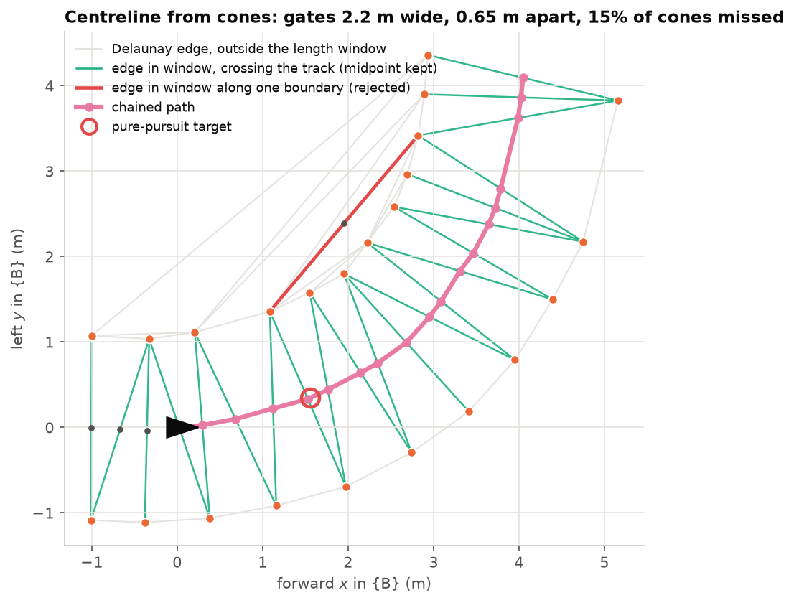
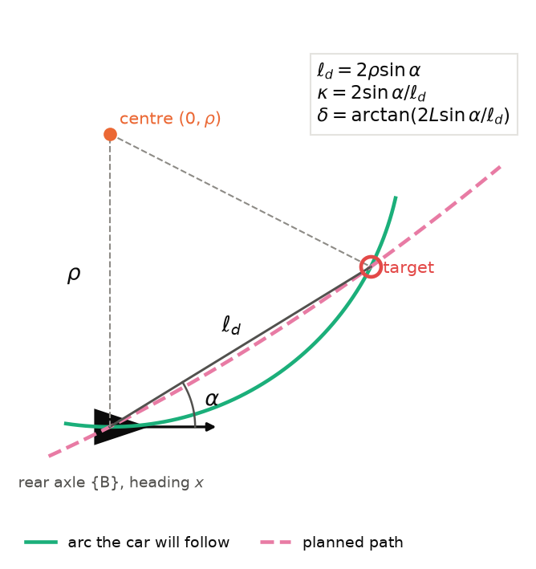

# Lecture 9 — Perception-Driven Racing: Planning from Cones

*Notebooks:* [08_cone_perception.ipynb](notebooks/08_cone_perception.ipynb) (§2–§3),
[09_classical_follower.ipynb](notebooks/09_classical_follower.ipynb) (§7–§8)

*Reading:* [Coulter92]; [Kabzan20] (perception and planning in a cone-racing system);
[Kaufmann23]; [deBerg08] ch. 9 (Delaunay triangulations).

*Further reading:* [Betz22], a survey of autonomous racing; [Snider09] on path-tracking controllers.

## Outcomes

After this lecture you can (i) build and characterise a classical cone detector, choosing a
ranging method from its error propagation; (ii) frame driving from a narrow-field camera as a
partially observable problem, and design a short-term memory that approximates the missing
state; (iii) train a policy on object-level (simulated) perception and validate it on pixels,
diagnosing where transfer fails; (iv) derive and implement a classical planner: centreline from a
Delaunay triangulation, pure-pursuit tracking and a feasible speed profile; (v) compare learned
and classical controllers on equal terms and argue which should drive.

## 1. The problem

L6's policy drove from a stored track and a localized pose: a driver with a perfect map and closed
eyes. That fails as soon as cones move. Here the car drives **only from the cones it sees**:

```
camera (colour + depth) ─► cone detector ─► cones in {B} ─► cone memory (odom frame) ─► planner ─► speed, steering
                                     ▲ odometry moves remembered cones as the car moves
```

The "planner" has two implementations with exactly the same input: a learned PPO policy (§3–§6)
and the classical cone follower (§7). The follower turned out to be faster, smoother and more
reliable, and it is what drives SAURCON (`saurcon_plan`); the learned policies are trained and
evaluated in MuJoCo (`saurcon_rl`). The comparison, and why it came out this way, is the subject
of §8.

**Partial observability.** The OAK-D sees ±33°. In a 2 m bend the cones that define the path are
*beside* the car, outside the image, for about a second. The camera image is therefore not a
Markov state: the decision depends on cones seen earlier. A principled answer is a belief over
cone positions; SAURCON uses a cheap approximation, a **memory** of recent detections kept in a
frame that does not move with the car (§3).

## 2. Detection and ranging

The detector (`saurcon_plan/cones.py`) is deliberately classical: it runs on a Raspberry Pi 4, its
behaviour is explainable, and its errors can be measured.

1. **Colour.** Threshold in HSV. Gazebo's cones render yellow-orange (hue ≈ 22), the warehouse's
   rack beams a deeper orange (hue 7–8), so a band of 15–32 with high saturation and value
   separates them; MuJoCo's cones render red-orange and use 0–14. Colour bands are parameters.
2. **Blobs**: connected components after a small morphological closing.
3. **Shape in pixels**: the blob's base must be below the horizon row ($v > c_y$, since cones stand
   on the floor below the camera) and the blob taller than wide.
4. **Range**, by the best available method (below).
5. **Shape in metres**: given range, the blob must be 3–12 cm tall, at most 7 cm wide, within 6.5 m.
6. **Position**: back-project the base pixel at range $Z$ into $\{C\}$ and transform to $\{B\}$.

**Three ranging methods and their errors.** For a cone of height $h_\text{cone} = 0.071$ m whose
base appears at row $v_b$, with the camera $h = 0.137$ m above a flat floor:

$$
Z_\text{ground} = \frac{f_y\,h}{v_b + \delta_v - c_y},\qquad
Z_\text{size} = \frac{f_y\,h_\text{cone}}{h_\text{px}},\qquad
\Big|\frac{\partial Z_\text{ground}}{\partial v_b}\Big| = \frac{Z^2}{f_y h},\qquad
\Big|\frac{\partial Z_\text{size}}{\partial h_\text{px}}\Big| = \frac{Z^2}{f_y h_\text{cone}}. \tag{9.1}
$$

Both errors grow as $Z^2$ (compare stereo, (2.4)), but ground-plane ranging has twice the lever arm
($h = 0.137$ m vs. 0.071 m) and depends only on the *bottom* row of the blob, which colour
segmentation finds reliably, whereas size ranging depends on the blob's full height, and the mask
often misses the cone's darker base, so heights read short and ranges long. Fitting on Gazebo
frames gave $h = 0.137$ m and $\delta_v = 1$ px.

| Method | Measured error (Gazebo) | Failure mode |
|---|---|---|
| stereo depth | good when present | holes on small, plain cones (§2 of L2) |
| **ground plane** | 3 cm (< 2 m), 5 cm (2–4 m), 8 cm (4–6.5 m) | assumes a flat floor and known camera height |
| size | ≈ 0.4 m at 2–6.5 m | segmentation of the full blob |

Figure 2.1 (Lecture 2) plots the three sensitivities against range.

## 3. Learning on object-level perception

**Simulated detections.** Rendering an image every step slows training 10–100×. The training
environment (`saurcon_rl/cone_env.py`) instead computes what the detector *would* report: every
cone within the field of view (±0.58 rad, slightly inside the lens so a cone straddling the edge is
not counted) and 0.35–6.5 m away, corrupted like the detector (range-dependent misses, bearing noise
0.004 rad, range noise $2\%\,r + \mathcal N(0, 0.006)\,r^2$). Separating perception from control
and training on perception *outputs* with an error model is standard practice: the champion-level
drone-racing policy of [Kaufmann23] was trained on state estimates with perception and dynamics
residuals fitted from real flights, and autonomous-driving planners are routinely developed on
object lists. The method moves the sim-to-real question from "do simulated pixels look real?" to
"does my detector's error look like the model?", which can be measured and fixed without retraining
the controller.

**Measuring the detector model.** The procedure: log detections and ground truth at every image;
*associate* each detection with a true cone; fit bias and spread of range and bearing error as
functions of range (a quadratic usually suffices; use a robust spread, 1.4826 × MAD, against
outliers); fit the miss probability by range (and bearing near the image edge); replace the
model's constants; and check by comparing simulated and real error histograms per range bin. In
notebook 08 (40 Gazebo frames), range error matched the hand-set model to ~5 m, but **miss rates
did not**: 77% at 1–2 m and 85% at 5–6 m, against 6% and 15% assumed. Near gate cones sat at the
edge of the view or below the image; far cones were a few pixels tall. The first analysis also
taught a lesson about *association*: matching by bearing alone paired far detections with the
wrong cone along a straight and reported a 1.2 m spread at 5 m; matching on bearing *and* range
gave the true 5–11 cm.

**Memory and observation.** The policy observes speed, yaw rate, steering, the previous action and
the 12 nearest **remembered** cones (forward, left, present, age): 53 numbers. `ConeMemory` stores
detections in the odom frame (the world in MuJoCo), merges a new detection within 0.3 m of a
remembered cone into it, and re-expresses all cones in the current $\{B\}$ every step,
${}^{B}\mathbf p = {}^{O}\mathbf C_{B}^\top({}^{O}\mathbf p - {}^{O}\mathbf t_{B})$. It needs no
localization, only odometry over a few seconds, which drifts millimetres. The policies were trained
with a 2 s horizon.

**Two details that decided whether training worked.** *Stalling:* with the measured miss rates,
training twice converged on parking, which earns zero reward and never crashes; terminating with the
crash penalty after 2 s below 0.3 m/s fixed it (L6 §4). *Evaluation conditions:* the lap evaluation
first disabled the detector's misses and noise for comparability, and a policy trained to expect
most cones missing, suddenly seeing all of them, crashed at the same spot on every evaluation while
its training reward rose. With the detector model left on, the same checkpoint lapped cleanly on
three seeds. **Evaluate under the conditions the policy will face.**

## 4. Validating on pixels, and five failures on the way to Gazebo

Training never sees an image, so validation must. `cone_drive.py` renders MuJoCo's onboard camera
(placed and scaled like the OAK-D, $f_x = 465.7$ px) and depth every 50 ms, runs the real detector
and drives from the result; on rendered images the detector placed cones within 1.3 cm RMS. MuJoCo
is the easy case (perfect depth, no blur or frame timing); Gazebo's simulated OAK-D is the hard one.
The first cone policy lapped in MuJoCo and never in Gazebo. Each failure was found by measuring:

1. **Starved camera.** Gazebo delivered 3–5 Hz instead of 15 Hz while training occupied every core,
   and requiring exact colour–depth pairs halved it again. *Fix at the time:* use each colour image
   with the most recent depth; never benchmark while training. (Part of this fix was a bug: see 5.)
2. **Poor ranging.** Stereo holes on small cones forced size ranging (≈0.4 m error), so bends looked
   farther than they were. *Fix:* ground-plane ranging (9.1).
3. **A unit conversion inside the simulator.** Gazebo's Ackermann plugin takes a yaw rate and, as a
   held command during acceleration showed, converts it with the car's *actual* speed,
   $\delta = \arctan(\dot\psi L/v_\text{actual})$, to four decimals. Commanding
   $\dot\psi = v_\text{cmd}\tan\delta/L$ over-steered while accelerating and under-steered while
   braking. *Fix:* convert with the measured speed.
4. **Blind in the bend.** Feeding the policy real and simulated detections for the same instants
   gave nearly identical actions, so perception was fine; but from 3.3 s it saw *no cones*: the bend
   was outside the field of view. *Fix:* the cone memory of §3.
5. **The fix that caused phantom cones.** Later, the classical follower ran wide in Gazebo bends
   while perfect in MuJoCo. Its per-step log showed remembered cones 0.5–1 m *outside* the track,
   only in bends. Each colour image was being paired with the *previous* depth image, 66 ms older;
   while turning, the old depth at a cone's pixel is often the floor behind it, so the cone was
   ranged too far. Failure 1's "most recent depth" was the cause. *Fix:* queue each image until the
   depth with the **same stamp** arrives, and look up the odometry pose at the image's own stamp (a
   50 ms pose lag at 2 rad/s rotates every cone of a frame by 6°). Every earlier result obtained
   through that node was affected (L7 §6).

**Lessons.** Profile rates, staleness and which ranging method ran before explaining anything.
Test each hypothesis alone. Compare decisions on real and simulated inputs to separate perception
error from everything else. Re-check old fixes when new symptoms appear. And note that failure 5 was
found only because the follower has a readable internal state, a planned path that can be plotted;
a policy's mistake shows up only as behaviour.

## 5. The weave, and how not to diagnose it

The learned policies weaved about ±0.25 m around the centreline on straights. A natural hypothesis
was that gates 1.17 m apart along the track made the policy chase individual cones, and the
racetrack was rebuilt with 2.2 m gates and extra gates in the bends. The weave remained. The right
first step was a measurement: resample the lateral offset on straights every 5 cm and take its
spectrum (`oscillation_plot.py`). The weave's wavelength was **5–13 m**, not 1.17 m; at 3 m/s that
is a 2–4 s period, a slow control-loop oscillation, not a response to cones. The steering command
also changed by 8.2° per 50 ms step on average: bang-bang steering smoothed only by the servo.
**A spectrum distinguishes "reacting to the environment" (wavelength = feature spacing) from "loop
oscillation" (wavelength set by speed and loop delay).**

**A reward for smooth driving.** The progress reward is indifferent to how the car steers. Three
changes in `cone_env.py`: the **servo slew limit** in the environment (8 rad/s), so the policy cannot
rely on steering it will not get; a **steering-rate penalty** $0.5\,\Delta a_\delta^2$ on the
normalised steering action; and a **yaw-excess penalty** $0.05\,(\dot\psi - v\kappa)^2$, which
charges only yaw rate beyond what the track's curvature requires, so turning *for the bend* is free
and weaving is not. Retrained in MuJoCo (one seed, cut short): steering change per step 4.2° (was
8.2°), offset standard deviation on straights 0.093 m (was 0.161 m), but a slower lap (25.25 s).

**Training in the target simulator.** The policy was also fine-tuned for ~3 M steps in lock-step
Gazebo (one headless server per environment, paused and stepped through its control service, with
the real detector on rendered frames, ~37 steps/s per server, about 100× slower than MuJoCo). It
reached a 23.6 s evaluation lap early, then got worse, and raced at 31.75 s with the same weave.
Training in the target simulator removes a modelling gap; it does not fix a reward that pays for
bang-bang steering. (That environment has since been removed from the code base.)

## 6. Results for the learned policies

| Policy | Environment | Result |
|---|---|---|
| cone memory, measured miss model | MuJoCo, simulated detector | clean laps, 21.1 s flying |
| same | Gazebo, ROS node, 1.2 m gates | one lap (~29 s), then ran wide |
| fine-tuned for 2.2 m gates | MuJoCo, simulated detector | 10/10 seeds, ~22.5 s |
| same | Gazebo, ROS node | 2 laps, 31.8 s |
| Gazebo fine-tune | Gazebo, ROS node | 1 lap, 31.75 s, weave ~0.5 m |
| smooth-driving reward | MuJoCo, simulated detector | 25.25 s, half the steering activity |

The Gazebo rows were obtained before the depth-pairing fix (§4, failure 5) and were not repeated
after it.

## 7. The classical cone follower

The follower (`saurcon_plan/cone_follower.py`) takes exactly the policy's input: remembered cones in
$\{B\}$ and the measured speed. It has three stages.

### 7.1 Centreline from a Delaunay triangulation

The **Delaunay triangulation** of a point set is the triangulation whose triangles have empty
circumcircles; among all triangulations it maximises the minimum angle, and it connects points to
their natural neighbours [deBerg08]. For cones along two roughly parallel boundaries, the
triangles span the track: each has an edge *across* it (a gate, length ≈ the gate width $w$, or a
diagonal to a neighbouring gate, length $\sqrt{w^2 + s^2}$ for along-track spacing $s$) and an edge
*along* one boundary (length ≈ $s$, much shorter). The midpoints of the across-track edges lie on
the centreline. The follower keeps edges with length in $[1.95, 2.75]$ m for $w = 2.2$ m:
the upper bound excludes infield chords; the lower bound matters too, because the inner rows of the
racetrack's two straights are only 1.8 m apart across the infield.

**Chaining.** From the rear axle, the path grows greedily: the next point is the midpoint 0.15–2.5 m
ahead within 70° of the current heading that minimises $r + 1.5\,|\Delta\psi|$, subject to two
validity tests. The source edge must **cross the path**: within 50° of perpendicular to the
current path heading. And the midpoint must be at least 0.6 m from every cone, since a true
centreline point is about $w/2 = 1.1$ m from all of them. Both tests reject chords between two cones
of the same boundary, which otherwise masquerade as gates when the cones between them are missed
(§7.5).



*Figure 9.1.* Algorithm 9.1 on a synthetic left bend with 0.65 m gate spacing and 15% of cones missed, computed by `saurcon_plan.cone_follower` itself. Grey: Delaunay edges outside the length window. Green: edges in the window that cross the track, whose midpoints (dots) are centreline candidates. Red: an edge in the window along the inner boundary, where missed cones left a gap; the crossing and clearance tests reject it. Magenta: the chained path and the pure-pursuit target.

**Single-boundary fallback.** In bends the camera often sees only the outer boundary. If the gate
path is shorter than 1 m, the follower chains the cones of one boundary, smooths the chain (3-point
moving average), offsets it by $w/2$ toward the car along its normals, keeps only points that make
forward progress, and drives it at ≤ 2.5 m/s.

### 7.2 Pure pursuit

Pure pursuit [Coulter92] steers toward a target point on the path a lookahead distance $\ell_d$
ahead. In $\{B\}$, let the target be at distance $\ell_d$ and bearing $\alpha$. The circle through the
rear axle, tangent to the heading, and through the target has radius $\rho$ satisfying
$\ell_d = 2\rho\sin\alpha$ (the chord of the circle subtending angle $2\alpha$), so

$$
\kappa = \frac{1}{\rho} = \frac{2\sin\alpha}{\ell_d},\qquad
\delta = \arctan(L\kappa) = \arctan\frac{2L\sin\alpha}{\ell_d}. \tag{9.2}
$$

Reference point and model match: (9.2) uses the rear axle, where the kinematic model (1.2) has no
sideslip. Lookahead trades stability for tracking: small $\ell_d$ tracks tightly and oscillates;
large $\ell_d$ cuts corners. The follower uses $\ell_d = 0.7 + 0.3\,v$ m (≤ 2.2 m), measured
along the path, from the pose predicted 50 ms ahead to cancel the measured sensing-to-actuation
delay [Snider09 compares pure pursuit with other geometric and model-based trackers].



*Figure 9.2.* Pure-pursuit geometry (9.2). The rear axle, tangent to the heading, and the target on the planned path at distance $\ell_d$ and bearing $\alpha$ define one circle; its curvature $2\sin\alpha/\ell_d$ gives the steering angle through the bicycle model.

### 7.3 Speed

The speed command is the minimum of four limits, a local, receding-horizon version of
Algorithm 1.1:

$$
v = \min\Big(v_{\max},\ \sqrt{v_\kappa^2 + 2b\,d_\kappa},\ \sqrt{2b\,(\ell_\text{path}-0.3)},\ \sqrt{a_\text{lat}L/|\tan\delta|}\Big),\qquad
v_\kappa = \sqrt{a_\text{lat}/\kappa_{\max}}. \tag{9.3}
$$

The second term brakes in time for the tightest curvature $\kappa_{\max}$ found at distance
$d_\kappa$ on the visible path (curvature from circles through points 0.4 m apart). The third
requires that the car can **stop within the path it can see**, which makes speed fall automatically
when perception degrades. The fourth caps lateral acceleration for the current steering angle. With
$a_\text{lat} = 5$ m/s² (half the grip), $b = 2.5$ m/s² and $v_{\max} = 5$ m/s, the margins absorb
late detection of bends. If no path is found the follower holds its last command while slowing,
and stops after 1 s.

> **Algorithm 9.1 (cone follower, every 50 ms).**
> 1. Delaunay-triangulate remembered cones; keep edges with length in $[1.95, 2.75]$ m; midpoints.
> 2. Chain midpoints from the rear axle (§7.1); if shorter than 1 m, use the boundary fallback.
> 3. Predict the pose 50 ms ahead; find the target $\ell_d$ along the path; steer by (9.2).
> 4. Speed by (9.3); apply the servo slew limit to the steering command.

### 7.4 Building it: each failure measured

| Symptom | Cause | Fix |
|---|---|---|
| Path wandered into the infield | inner rows of the straights 1.8 m apart, paired as a gate | edge window lower bound 1.95 m |
| Path jumped onto a boundary | chord between two same-side cones whose neighbours were missed | edge must cross the path |
| Ran wide on bend exits | only outer cones visible, no gates | single-boundary fallback |
| Overran the first bend | bend seen late, braking planned at the grip limit | $b = 2.5$ m/s², $v_{\max} = 5$ m/s |
| Not slowing for short bends | curvature evaluated at path distance 0 wrapped to the path's end (an off-by-one in arc-length interpolation): 0.013 m⁻¹ reported for a 1.7 m⁻¹ bend | boundary handled; regression test bends a short path |

### 7.5 A new track exposes two more

A second world, with tighter bends (~3 m radius) and gates only **0.65 m** apart, exposed two
failures; in both, the car left the track in a left bend on lap 2 or 3. Replaying the per-step log:

1. **A boundary chord taken for a gate.** With 0.65 m spacing, two cones three apart on one side are
   ≈2.0 m apart, inside the gate window. The crossing test originally compared the edge with the
   direction *to its midpoint*; for a chord right beside the car that direction is steep, so the
   chord passed. Testing against the *path heading* and requiring 0.6 m clearance from every cone
   (§7.1) fixed it: over every logged step of the failed runs, planned paths touching a cone fell
   from 66 and 65 steps to 1 and 0.
2. **Inner cones forgotten too early.** The inner cones of a tight bend leave the view well before
   the car passes them, and at bend speed (~2 m/s) the 2 s memory had dropped them. With no inner
   side there are no gates, only the noisy outer row. The 2 s horizon was chosen for the policies,
   which were trained with it; the follower ignores cone ages, so it now remembers cones for 5 s.

Afterwards: one 3-lap mapping run and two 3-lap localization runs, all clean (17.7–18.6 s per lap),
against 0 of 2 before. **Lessons:** a parameter tuned for one consumer can be wrong for another; a
test written for one geometry can pass for the wrong reason on another; and failing frames from
real runs make the best regression tests (`test_cone_follower.py` keeps two).

## 8. Learned vs. classical

| Controller | Environment | Result |
|---|---|---|
| Classical follower | MuJoCo, rendered pixels | 11.85 s flying lap |
| Classical follower | MuJoCo, simulated detector | 8/8 seeds clean |
| Classical follower | Gazebo, 30% of frames dropped | 5/5 clean |
| Classical follower | Gazebo, ROS | 11.7–13.3 s laps; lateral offset std 0.04 m |
| Classical follower + RTAB-Map | Gazebo, no markers, racetrack and feature warehouse | 3-lap runs clean after the fixes of §4 and §7.4–7.5 (1 of 3 clean before) |
| Best learned policy | Gazebo, ROS | 31.8 s laps; weave ~0.5 m |

The follower lapped more than twice as fast with a tenth of the weave, and transferred from MuJoCo to
Gazebo without tuning. The reasons are worth stating precisely, because they predict when the
outcome would reverse:

- **The structure is known.** "The centreline is the midpoint of each gate" is the whole task. The
  follower is told it; the policy must discover it from 12 noisy points and a progress reward, and
  can find degenerate solutions (parking, weaving) on the way.
- **It is inspectable.** Its path can be plotted every frame; that is how failure 5 was found.
- **It degrades gracefully.** Dropping 30% of frames changed nothing; the policies were sensitive
  to the detector's miss rate (§3).

Learning earns its place where the structure is *not* known or the limit is in the dynamics: driving
at the grip limit, using the full track width, recovering from slides, situations the rules do not
cover. The strong designs combine the two: the classical path as the policy's observation, RL tuning
the classical controller's parameters, or a **residual policy** that adds a learned correction to the
classical command [Johannink19], always measured against the classical baseline (L6 §7).

## 9. Stopping on stale inputs

The follower's node drives only when its image, odometry and transform are fresh by their own
timestamps, and publishes zero otherwise (L5 §4). Normal latency (a pose 50–100 ms old) is still
extrapolated with the measured speed and yaw rate; arbitrary staleness is never treated as normal.
Under SLAM load these rules stop the car for single steps on about 6% of steps, which costs ~0.3 s
per lap and is the right default.

## In SAURCON

| Concept | Where |
|---|---|
| Detector, cone map, scoring | `src/saurcon_plan/saurcon_plan/cones.py` |
| Cone memory | `src/saurcon_plan/saurcon_plan/memory.py` |
| Classical follower (Algorithm 9.1) | `src/saurcon_plan/saurcon_plan/cone_follower.py` |
| ROS 2 node (camera in, `/auto_cmd` out) | `src/saurcon_plan/saurcon_plan/cone_follower_node.py`, launch `cone_follower:=true` |
| Cone mapping with truth or RTAB-Map poses | `src/saurcon_plan/saurcon_plan/cone_mapper_node.py`, launch `cone_mapping:=` |
| Simulated detector, observation, smooth reward (RL) | `src/saurcon_rl/saurcon_rl/cone_env.py` |
| Policies or the follower on rendered MuJoCo pixels | `src/saurcon_rl/saurcon_rl/cone_drive.py` |
| Track layout (gate width, bend gates) | `src/middle_earth/scripts/add_cone_gates.py` |
| Race harness, videos, weave spectrum | `scripts/sim_eval/cone_race.sh`, `make_race_video.py`, `oscillation_plot.py` |
| Tests | `src/saurcon_plan/test/`, `src/saurcon_rl/test/` |

```bash
# Classical follower in Gazebo, 3 laps, with RTAB-Map mapping and no ArUco markers
scripts/sim_eval/cone_race.sh classical_slam 3 \
    world:=$PWD/evaluation/worlds/no_markers.world slam:=true cone_mapping:=rtab
.venv-rl/bin/python scripts/sim_eval/make_race_video.py evaluation/cones_gz/classical_slam out.mp4
# The same follower in MuJoCo, from rendered pixels
.venv-rl/bin/python -m saurcon_rl.cone_drive --model classical --laps 2 --video classical_mujoco.mp4
```

## Summary

- A narrow camera makes racing partially observable; a short memory in the odom frame is a cheap,
  effective belief approximation.
- Ground-plane ranging beats size ranging by geometry, not by tuning; propagate pixel errors to see
  why.
- Train on object-level perception with a *measured* detector model, and evaluate under the
  conditions the policy will face.
- Delaunay triangulation, pure pursuit and a stop-within-sight speed profile make a planner that is
  fast, robust and inspectable; on a structured task it beats learning, and it is the baseline any
  learned controller must beat.

## Problems

**9.1** [T] ★ Using (9.1), compute the range error from a one-pixel error at 2, 4 and 6 m for
ground-plane and size ranging, with $f_y = 465.7$ px.

**9.2** [T] ★ Derive (9.2) from the geometry of the circle through the rear axle and the target.

**9.3** [C] ★ In notebook 08, set the memory horizon to 0 and drive the scripted bend. How many cones
does the observation contain mid-bend?

**9.4** [C] ★★ Carry out the detector-model fit of §3 on a full Gazebo lap: fit $\sigma(r)$ and
$p_\text{miss}(r)$ with confidence bands, and compare with `MISS_PROB` in `cone_env.py`.

**9.5** [T] ★★ For gates of width $w$ and along-track spacing $s$ on a straight, list the Delaunay
edge lengths. For which $s$ does a same-side chord fall inside the window $[1.95, 2.75]$ m? Relate
your answer to §7.5.

**9.6** [C] ★★ Run `oscillation_plot.py` on a follower run in Gazebo and on a learned policy in
MuJoCo. Where are the spectral peaks, and what sets them?

**9.7** [C] ★★ Raise the follower's $a_\text{lat}$ from 5 m/s² in steps in MuJoCo. Where does it begin
to fail, and is the failure in perception, planning or dynamics?

**9.8** [C] ★★★ Implement occlusion in the simulated detector (drop cones whose bearing interval is
covered by a nearer cone or obstacle) and measure its effect on a trained policy and on the follower.

**9.9** [C] ★★★ Make the follower's path the observation of an RL policy, or train a residual policy on
top of the follower's command. Does either beat the follower on lap time without losing its
robustness? Report over five seeds (L7 §5).

### Answers to selected problems

**9.1** $f_y h = 63.8$ px·m and $f_y h_\text{cone} = 33.1$ px·m. Ground plane: $Z^2/63.8$ = 6 cm,
25 cm, 56 cm per pixel; size: $Z^2/33.1$ = 12 cm, 48 cm, 1.09 m per pixel. The measured ground-plane
errors (3–8 cm) are smaller than one pixel's worth because the base row is located consistently to
better than a pixel; the size method suffers its full sensitivity plus a systematic bias.

**9.2** A circle tangent to the $x$-axis at the origin has its centre at $(0, \rho)$. A point at
distance $\ell_d$ and bearing $\alpha$ lies on it when
$(\ell_d\cos\alpha)^2 + (\ell_d\sin\alpha-\rho)^2 = \rho^2$, i.e. $\ell_d^2 = 2\rho\,\ell_d\sin\alpha$,
so $\kappa = 1/\rho = 2\sin\alpha/\ell_d$; the bicycle model then gives $\tan\delta = L\kappa$.

**9.5** Gate edges $w$; diagonals $\sqrt{w^2+(ks)^2}$; same-side chords $ks$. A chord $3s$ enters the
window when $3s\ge1.95$ m, i.e. $s\ge0.65$ m, exactly the feature warehouse's spacing; a chord $2s$
does when $s\ge0.975$ m, and the racetrack's $s = 1.17$ m puts $2s = 2.34$ m inside it. The window
alone cannot reject chords, which is why the follower also needs the crossing and clearance tests.
