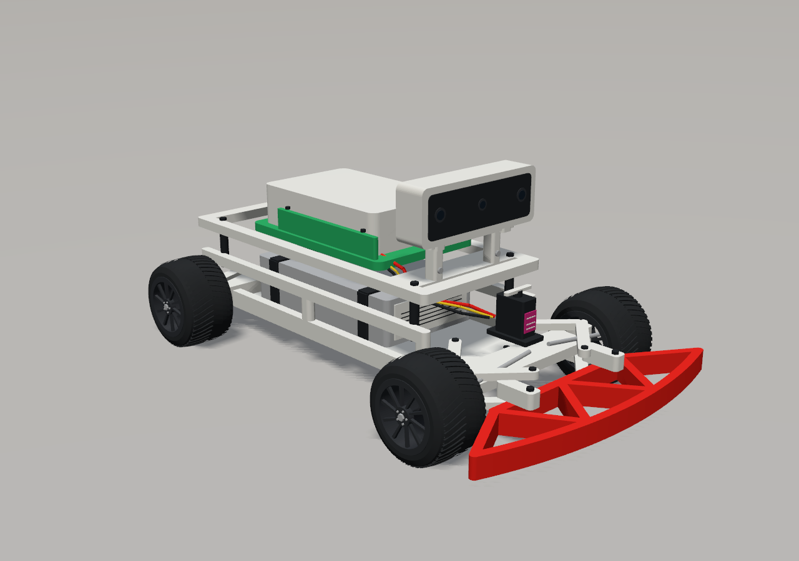

# SAURCON Gazebo vehicle

The appearance follows the supplied photographs of the real car: an open white
printed chassis, red front truss bumper, black treaded tyres and spoke wheels,
exposed steering arms and servo, battery straps, green electronics carrier, and
the OAK-D in a white cradle with a dark three-lens face.



## Visuals and physics

The appearance meshes are used exclusively in `<visual>` elements. The original
link names and poses, coordinate frames, mass and inertia tensors, collision
geometry and contact properties, joints, steering plugin, and sensor settings
are preserved. Wheel details live on the original wheel links and rotate/steer
with them. The camera housing lives on the existing `oak_d_lite` model's `oak`
link; its RGB, stereo and IMU frames have not moved.

The camera face and housing remain behind the optical origins. The onboard RGB
preview was checked for obstruction by the new vehicle geometry.

The meshes are deterministic, metre-scale COLLADA assets generated without
third-party modelling dependencies. Regenerate from the workspace root:

```bash
python3 src/middle_earth/scripts/build_vehicle_visuals.py
```

The generator checks that every non-visual SDF element is unchanged before
writing either model. Edit the generator rather than hand-editing its meshes.

## Preview and validation

Render four external views and an onboard image with the actual Gazebo renderer:

```bash
source /opt/ros/jazzy/setup.bash
python3 scripts/sim_eval/preview_vehicle.py evaluation/vehicle_visuals/preview
```

This uses an isolated Gazebo partition and a static vehicle instance in a
temporary studio world. It does not start ROS or send driving commands. The
real model remains dynamic in the normal simulation.

Check the SDF and nested camera resolution:

```bash
export SDF_PATH="$PWD/src/middle_earth/models"
gz sdf -k src/middle_earth/models/rc_ackermann_vehicle/model.sdf
gz sdf -k src/middle_earth/models/oak_d_lite/model.sdf
```

For the 2026-11-13 appearance update, both checks passed; the non-visual XML
matched the pre-edit snapshots, and Gazebo's reported vehicle inertia statistics
were identical before and after. The standalone statistics exclude nested
models, so the OAK-D's non-visual XML was also checked independently.
